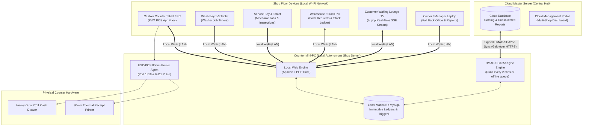
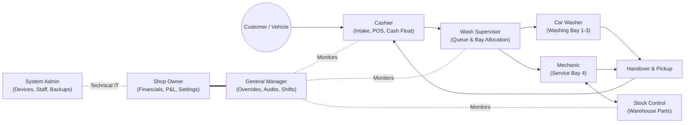

# 01. System Architecture & Roles Overview
**Document Reference**: `docs/user_guide/01_OVERVIEW.md`  
**Target Audience**: Shop Owners, General Managers, System Administrators, New Employees

---

## 1. How the System Fits Together

The Car Wash & Detailing Management System is an **offline-first, autonomous local shop system** connected periodically to a central **Cloud Master Hub**. If the internet cuts out, fiber cables are damaged, or severe weather hits, **the shop continues washing cars, changing oil, calculating change, and printing receipts without interruption**.

### The 4 Core Building Blocks

1. **The Counter Mini-PC (The Heart of the Shop)**:
   - A dedicated small computer located at the cashier counter or back office running Windows with XAMPP (Apache web server and MySQL database).
   - Stores all customer records, sales transactions, vehicle history, and inventory movements locally.
   - Houses the automated daily backup system (`scripts/backup_daily.php`) and the background sync daemon (`scripts/sync_runner.php`).

2. **The Cloud Master Hub**:
   - The central web portal accessible from anywhere by the shop owner on a mobile phone or laptop.
   - Synchronizes catalog items, prices, staff accounts, and software settings down to the shop.
   - Receives daily sales, performance metrics, technician timesheets, and customer loyalty data up from the shop.

3. **Shop Floor Tablets & Screens (Connected via Local Wi-Fi)**:
   - **Cashier POS Tablet**: Built as an ultra-fast Progressive Web App (PWA) with offline caching. Staff can tap services, scan license plates, calculate dual-currency change (USD & KHR), and process payments.
   - **Wash Bay Screen (`views/washer/jobs.php`)**: Ruggedized tablet in the wash tunnel showing assigned cars, wash package instructions, and start/finish buttons.
   - **Mechanic Screen (`views/mechanic/jobs.php`)**: Tablet mounted at Bay 4 for oil change checklists, oil capacity lookup, actual fluid adjustments, and parts requests.
   - **Customer TV (`tv.php`)**: A large display in the waiting lounge powered by a smart TV or HDMI stick showing real-time queue progress, ready-for-pickup notifications, and estimated wait times.

4. **Physical Counter Hardware**:
   - **80mm ESC/POS Thermal Printer**: Prints customer job receipts with vehicle details and itemized pricing.
   - **RJ11 Cash Drawer**: Automatically kicks open via a hardware electrical pulse from the printer upon tender completion or authorized manager override.

---

## 2. Who Does What: The 11 System Roles

The system uses strict **Separation of Duties** to protect shop cash, prevent inventory shrinkage, and eliminate unauthorized discounts.

### 1. Shop Owner (`owner` / ម្ចាស់ហាង)
- **Primary Mission**: Business profitability, capital safety, and strategic growth.
- **What They Can Do**: Access all 28 back-office screens, view executive revenue dashboards, export detailed P&L reports, pay crew commissions, approve expense vouchers, configure system settings, and inspect security audit logs.
- **What They Cannot Do**: The owner role has no functional restrictions, but must follow system controls (e.g. providing reasons for stock adjustments).

### 2. General Manager (`manager` / អ្នកចាត់ការទូទៅ)
- **Primary Mission**: Daily floor leadership, queue pacing, fraud prevention, and customer satisfaction.
- **What They Can Do**: Conduct unannounced cash spot audits, verify bank transfer payment slips, authorize on-screen discounts and order cancellations with manager PIN, approve warehouse parts requests, reorder queue bays, correct staff timecards, and review operational reports.
- **What They CANNOT Do**: Cannot view owner financial dashboards (`dashboard.view`), cannot export executive profit reports, cannot pay out payroll commissions, cannot delete expense ledgers, and cannot modify system RBAC roles or database settings.

### 3. Cashier (`cashier` / បេឡាករ)
- **Primary Mission**: Accurate order intake, friendly customer engagement, and penny-perfect cash management.
- **What They Can Do**: Register customer arrivals and license plates, enter vehicle size, select wash and oil packages, apply pre-approved promotional coupons, receive cash in USD and KHR, print itemized receipts, start/end cashier shifts, and perform emergency paper-recovery entry.
- **What They CANNOT Do**: **STRICTLY CANNOT cancel an order or issue a refund**. Cannot open the cash drawer without a sale unless authorized by a Manager PIN. Cannot access financial reports, adjust stock levels, or alter service prices.

### 4. Car Washer (`washer` / បុគ្គលិកលាង)
- **Primary Mission**: Thorough cleaning, vehicle paint safety, and rapid turnaround.
- **What They Can Do**: View assigned wash bay vehicles on tablet (`washer_jobs.view`), tap "Start Wash", tap "Finish Wash", assign themselves to an open vehicle, and inspect their personal wash commission totals.
- **What They CANNOT Do**: Cannot view customer phone numbers, cannot touch billing or payments, and cannot access warehouse parts or settings.

### 5. Wash Supervisor (`wash_supervisor` / ប្រធានត្រួតពិនិត្យការលាង)
- **Primary Mission**: Flow management, bay utilization, quality control, and bottleneck elimination.
- **What They Can Do**: Drag-and-drop vehicles between Bays 1, 2, and 3; reorder queue priority; reassign wash crew members; record vehicle delays; inspect mechanic bay progress; and verify final vehicle cleanliness before customer handover.
- **What They CANNOT Do**: Cannot access cashier drawers, process money payments, modify product inventory, or access financial reports.

### 6. Mechanic & Technician (`mechanic` / ជាងជួសជុល & បច្ចេកទេស)
- **Primary Mission**: High-quality vehicle maintenance, precision fluid servicing, and mechanical safety.
- **What They Can Do**: Open Bay 4 tablet screen (`mechanic_jobs.view`), execute 2-lane workflow (Lane 1: Mechanical/Oil, Lane 2: Guided Safety Inspection), lookup engine oil specs, record actual oil liters dispensed, request replacement filters from warehouse, and record vehicle diagnostic notes.
- **What They CANNOT Do**: Cannot alter retail service prices, cannot approve their own parts requests, and cannot access cash registers or sales reports.

### 7. Technical Staff (`technical` / ជាងបច្ចេកទេស)
- **Primary Mission**: Vehicle safety inspections and maintenance diagnostics.
- **What They Can Do**: Complete digital safety inspection checklists (tires, brakes, fluids, battery), submit parts requests, and inspect vehicle service histories.
- **What They CANNOT Do**: Cannot approve warehouse disbursements, take payments, or edit system settings.

### 8. Stock Control / Warehouse (`stock_control` / អ្នកគ្រប់គ្រងស្តុក)
- **Primary Mission**: Inventory accuracy, loss prevention, and supplier receiving.
- **What They Can Do**: Manage parts catalog (`oil_care.list`, `extras.list`), approve or reject mechanic parts requests with mandatory reason codes, log physical count discrepancies, record new stock deliveries, and inspect the immutable stock ledger.
- **What They CANNOT Do**: Cannot handle customer cash, cannot view payroll commissions, and cannot delete transactions from the stock ledger.

### 9. CRM Coordinator (`crm` / អ្នកសម្របសម្រួល CRM)
- **Primary Mission**: Customer retention, fleet accounts, and service maintenance reminders.
- **What They Can Do**: Maintain customer profiles, register corporate vehicle fleets, configure maintenance reminder schedules (oil change, wash win-back), and lookup vehicle service histories.
- **What They CANNOT Do**: Cannot access cash drawers, alter service pricing, or view financial profit reports.

### 10. System Administrator (`system_admin` / អ្នកគ្រប់គ្រងប្រព័ន្ធ)
- **Primary Mission**: Hardware stability, security enforcement, and infrastructure continuity.
- **What They Can Do**: Pair and block POS tablet devices, manage staff login accounts and reset PINs, manage role permissions, configure technical network settings, download database backups, and inspect security audit logs.
- **What They CANNOT Do**: **STRICTLY BLOCKED from viewing financial sales reports, cash drawers, or daily revenue figures**. (Maintains technical/financial separation of duties).

### 11. Customer (`customer` / អតិថិជន)
- **Primary Mission**: Relax in the customer lounge while monitoring vehicle progress.
- **What They Can Do**: View the public TV screen (`tv.php`) displaying queue numbers, license plates, bay numbers, and "Ready for Pickup" banners.
- **What They CANNOT Do**: Cannot log into the back office or access any shop database functions.

---

## 3. Master Role Permissions Matrix

The table below reflects the exact permission records configured in the database (`roles` and `role_permissions`):

| Functional Permission Area | Permission Code | `owner` | `manager` | `cashier` | `wash_sup` | `washer` | `mech` | `stock` | `admin` |
| :--- | :--- | :---: | :---: | :---: | :---: | :---: | :---: | :---: | :---: |
| **Executive Dashboard** | `dashboard.view` | **YES** | NO | NO | NO | NO | NO | NO | NO |
| **POS Register Access** | `pos.access` | **YES** | **YES** | **YES** | NO | NO | NO | NO | NO |
| **Create Sales Order** | `pos.create_order` | **YES** | **YES** | **YES** | NO | NO | NO | NO | NO |
| **Apply Order Discount** | `pos.discount` | **YES** | **YES** | **YES** | NO | NO | NO | NO | NO |
| **Accept Customer Payment** | `pos.pay_order` | **YES** | **YES** | **YES** | NO | NO | NO | NO | NO |
| **Debt / Pay Later** | `pos.pay_later` | **YES** | **YES** | **YES** | NO | NO | NO | NO | NO |
| **Cancel / Void Order** | `pos.cancel_order` / `orders.cancel` | **YES** | **YES** | **BLOCKED** | NO | NO | NO | NO | NO |
| **Reprint Receipts** | `pos.receipt` | **YES** | **YES** | **YES** | NO | NO | NO | NO | NO |
| **Order Queue List** | `orders.list` | **YES** | **YES** | **YES** | **YES** | NO | NO | NO | NO |
| **Change Crew Member** | `orders.change_crew` | **YES** | **YES** | **YES** | **YES** | NO | NO | NO | NO |
| **View Wash Bays** | `bays.view` | **YES** | **YES** | **YES** | **YES** | **YES** | **YES** | NO | NO |
| **Assign Car to Bay** | `bays.assign` | **YES** | **YES** | **YES** | **YES** | **YES** | **YES** | NO | NO |
| **Finish Vehicle in Bay** | `bays.finish` | **YES** | **YES** | **YES** | **YES** | **YES** | **YES** | NO | NO |
| **Reorder Queue Priority**| `bays.move_queue` / `bays.manage` | **YES** | **YES** | NO | **YES** | NO | NO | NO | NO |
| **Washer Job Screen** | `washer_jobs.view` | **YES** | **YES** | NO | **YES** | **YES** | NO | NO | NO |
| **Mechanic Job Screen** | `mechanic_jobs.view` | **YES** | **YES** | NO | **YES** | NO | **YES** | NO | NO |
| **Safety Inspection Checklist**| `inspection.manage` | **YES** | **YES** | NO | NO | NO | **YES** | NO | NO |
| **Request Parts from Bay** | `parts_requests.create` | **YES** | NO | NO | NO | NO | **YES** | NO | NO |
| **Approve Parts Request** | `parts_requests.approve` | **YES** | **YES** | NO | NO | NO | NO | **YES** | NO |
| **Warehouse Parts Catalog** | `extras.list` / `oil_care.list` | **YES** | **YES** | **YES** | NO | NO | NO | **YES** | NO |
| **Adjust Stock Quantity** | `extras.adjust_stock` | **YES** | NO | NO | NO | NO | NO | **YES** | NO |
| **Log Count Discrepancy** | `discrepancy.manage` | **YES** | **YES** | NO | NO | NO | NO | **YES** | NO |
| **Customer Registry** | `customers.list` / `edit` | **YES** | **YES** | **YES** | NO | NO | NO | NO | NO |
| **Shift Start & Close** | `pos.access` | **YES** | **YES** | **YES** | NO | NO | NO | NO | NO |
| **Close Day & Z-Report** | `daily_close.close` | **YES** | NO | **YES** | NO | NO | NO | NO | NO |
| **Crew Commissions Payroll**| `commissions.list` / `pay` | **YES** | NO | NO | NO | NO | NO | NO | NO |
| **Expense Vouchers** | `expenses.list` / `add` | **YES** | NO | NO | NO | NO | NO | NO | NO |
| **Financial Reports** | `reports.view` | **YES** | **YES** | NO | NO | NO | NO | NO | NO |
| **Export Reports (CSV/Excel)**| `reports.export` | **YES** | NO | NO | NO | NO | NO | NO | NO |
| **Manage Staff & PINs** | `staff.list` / `reset_password` | **YES** | NO | NO | NO | NO | NO | NO | **YES** |
| **Role & Security Editor**| `roles.list` / `edit` | **YES** | NO | NO | NO | NO | NO | NO | **YES** |
| **POS Hardware Terminals**| `pos_devices.*` | **YES** | NO | NO | NO | NO | NO | NO | **YES** |
| **Shop Settings** | `settings.view` / `edit` | **YES** | NO | NO | NO | NO | NO | NO | **YES** |
| **Cloud Sync Monitor** | `sync.view` / `manage` | **YES** | **YES** | NO | NO | NO | NO | NO | NO |
| **Security Audit Logs** | `audit.view` | **YES** | NO | NO | NO | NO | NO | NO | **YES** |
| **Disaster Recovery Forms**| `recovery.view` / `create` | **YES** | **YES** | **YES** | NO | NO | NO | NO | NO |

---

## 4. Key Rules for Shop Owners

1. **Never Share PINs**: Every cashier, washer, mechanic, and manager must use their own personal 6-digit PIN. The system records all actions to an immutable audit ledger with the staff member's user ID.
2. **Cashiers Cannot Cancel**: If a customer changes their mind or an order was entered in error, a **Manager or Owner must enter their PIN on the screen to confirm the cancellation**.
3. **The Shop Works Without Internet**: Never panic if the fiber connection goes down. The counter Mini-PC handles sales, jobs, receipts, and shifts locally. Once internet returns, the background sync engine pushes transactions automatically.
4. **Enforce the Receipt Rule**: *"No Receipt, No Wash"*. Every customer must receive a printed thermal ticket. The receipt number matches the queue ticket on the TV screen.
