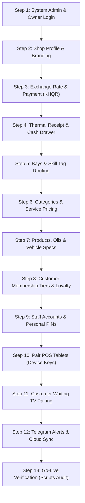

# 02. First-Time Setup & Go-Live Checklist
**Document Reference**: `docs/user_guide/02_FIRST_TIME_SETUP.md`  
**Target Audience**: Shop Owner, System Administrator  
**Frequency**: Steps 1 to 12 are **ONE-TIME SETUP** during shop commissioning; Step 13 (Price & Staff updates) is **REPEATED AS NEEDED**.

---

## 1. Overview of the Setup Sequence

Setting up a brand-new car wash and detailing facility must follow this strict sequence so that the POS, wash bays, and printer have the data they need to operate:



---

## 2. Step-by-Step Setup Instructions

### Step 1: Initial Login & Password Change *(One-Time)*
- **Who does it**: Shop Owner or System Administrator.
- **Where**: Open a web browser on the Counter Mini-PC and go to:  
  `http://localhost/Car-WashService/index.php?view=login`
- **What you see**: The Car Wash Pro login screen asking for **Username** and **Password / PIN**.
- **Action**:
  1. Enter your temporary owner username and PIN.
  2. The system automatically detects first-time login and redirects to the **Change PIN** screen (`view=change_pin`).
  3. Enter your current PIN and a new secret 6-digit personal PIN. Click **Save New PIN** *(រក្សាទុកលេខកូដថ្មី)*.
- **What can go wrong & what to do**:
  - *Symptom*: Red message *"Account locked for 10 minutes after 5 failed PIN attempts"*.
  - *Fix*: Wait 10 minutes for the security timer to expire, or run the command line unlock tool:  
    `php scripts/dev_reset_logins.php --apply --users=owner`

---

### Step 2: Shop Profile & Branding *(One-Time)*
- **Who does it**: Shop Owner.
- **Where**: Go to navigation menu **Shop Settings** *(ការកំណត់ហាង)* &rarr; Click tab **Shop Info** (`tab=shop`).
- **What you see**: Input fields for English and Khmer shop names, phone number, address, and logo uploader.
- **Action**:
  1. Enter **Shop Name (English)**: e.g., `AquaGleam Car Wash & Detailing`.
  2. Enter **Shop Name (Khmer)**: e.g., `អាខ្វាហ្គ្លីម សេវាកម្មលាងរថយន្ត និងម៉ូតូទំនើប`.
  3. Enter **Phone Number**: e.g., `012 334 556`.
  4. Enter **Shop Address**: e.g., `Street 271, Sangkat Boeung Tumpun, Phnom Penh`.
  5. Upload **Shop Logo**: Click *Choose File*, select a transparent PNG or JPG under 2.0 MB.
  6. Click **Save Shop Settings** *(រក្សាទុកការកំណត់)*.
- **What can go wrong & what to do**:
  - *Symptom*: Error *"The uploaded file is too large (X MB). Maximum allowed size is 2.0 MB"*.
  - *Fix*: Resize your logo image in Paint or a photo editor to under 800x800 pixels before uploading.

---

### Step 3: Dual Currency & KHQR Payment Setup *(One-Time)*
- **Who does it**: Shop Owner.
- **Where**: Settings &rarr; Click tab **Money & Currency** (`tab=money`), then tab **Payment & KHQR** (`tab=payment`).
- **What you see**: Currency exchange rate fields and bank account information.
- **Action**:
  1. On **Money & Currency** tab:
     - Set **Exchange Rate (KHR per 1 USD)**: Default is `4100` (or `4150` according to current market rates).
     - Set **Tax Rate Percent**: Enter `0` or `10` if VAT applies.
     - Click **Save Currency Settings**.
  2. On **Payment & KHQR** tab:
     - Enter **Bank Name**: e.g., `ABA Bank` or `Canadia Bank`.
     - Enter **Account Name**: e.g., `AQUAGLEAM CAR WASH`.
     - Enter **Account Number**: e.g., `000 123 456`.
     - Upload **KHQR Code Image**: Upload your shop's official Bakong/ABA KHQR PNG image.
     - Click **Save Payment Settings**.
- **What can go wrong & what to do**:
  - *Symptom*: POS displays wrong Riel conversion on customer receipts.
  - *Fix*: Re-open `tab=money` and ensure the exchange rate is an integer without commas or periods (e.g. `4150`, not `4,150`).

---

### Step 4: 80mm Thermal Receipt Printer & Cash Drawer *(One-Time)*
- **Who does it**: Shop Owner or Cashier Lead.
- **Where**: Settings &rarr; Click tab **Receipt** (`tab=receipt`).
- **What you see**: Header/footer preview, receipt logo uploader, and local printer bridge settings.
- **Action**:
  1. Enter **Receipt Header (Khmer & English)**: Welcome message, e.g., *"សូមស្វាគមន៍ / Welcome to AquaGleam"*.
  2. Enter **Receipt Footer (Khmer & English)**: e.g., *"សូមពិនិត្យទ្រព្យសម្បត្តិមុនចាកចេញ / Please check your belongings before leaving"*.
  3. Ensure **Receipt Rule Notice** is enabled: *"No Receipt, No Wash" (គ្មានវិក្កយបត្រ គ្មានការលាង)*.
  4. Ensure your USB thermal printer is plugged into the Mini-PC and powered ON.
  5. Test cash drawer pulse: Click **Test Drawer Kick** button; the metal cash drawer should immediately click open.
- **What can go wrong & what to do**:
  - *Symptom*: Printer does not print or drawer does not open.
  - *Fix*: Check that the printer USB cable is connected and the Node printing bridge is running:  
    Open terminal and run: `node scripts/counter-printer-service.js`

---

### Step 5: Wash Bays & Skill Tag Routing *(One-Time)*
- **Who does it**: Shop Owner or Wash Supervisor.
- **Where**: Settings &rarr; Click tab **Bays & Routing** (`tab=bays`).
- **What you see**: A table of physical vehicle servicing bays.
- **Action**:
  1. Verify the 4 default physical bays match your shop floor layout:
     - **Bay 1**: Name: `Bay 1 (Wash Tunnel)`, Lane: `wash`, Skill Tag: `wash`.
     - **Bay 2**: Name: `Bay 2 (Foam Wash)`, Lane: `wash`, Skill Tag: `wash`.
     - **Bay 3**: Name: `Bay 3 (Hand Detail)`, Lane: `wash`, Skill Tag: `wash`.
     - **Bay 4**: Name: `Bay 4 (Lube & Repair)`, Lane: `mechanical`, Skill Tag: `oil_change,repair`.
  2. If your shop has extra wash bays, click **+ Add New Bay**, enter the bay name and select lane type `wash`.
  3. Click **Save Bay Configuration**.
- **What can go wrong & what to do**:
  - *Symptom*: Oil change orders accidentally get assigned to a washing bay.
  - *Fix*: Ensure Bay 4 has lane type set strictly to `mechanical` or `both`, never `wash` only.

---

### Step 6: Categories & Service Pricing Matrix *(One-Time, then Repeated)*
- **Who does it**: Shop Owner.
- **Where**: Navigation menu **Services & Prices** *(សេវាកម្ម & តម្លៃ)* (`index.php?view=services`).
- **What you see**: The catalog of cleaning and detailing services with tiered pricing for 4 vehicle sizes.
- **Action**:
  1. Click **+ Add New Service** *(បន្ថែមសេវាកម្មថ្មី)* or click **Edit** on existing services.
  2. Fill in:
     - **Service Name (English)**: e.g., `Standard Foam Wash`.
     - **Service Name (Khmer)**: e.g., `លាងជម្រះស្នោស្តង់ដារ`.
     - **Category**: Select `Wash`.
     - **Base Duration (Minutes)**: e.g., `25`.
  3. Enter the **Pricing Matrix by Vehicle Size**:
     - **Motorbike** *(ម៉ូតូ)*: Price USD: `$1.50` | KHR: `6,150` | Est. Min: `15`
     - **Small Car / Sedan** *(រថយន្តតូច)*: Price USD: `$3.50` | KHR: `14,350` | Est. Min: `25`
     - **SUV / Pickup** *(រថយន្តធុនកណ្តាល)*: Price USD: `$5.00` | KHR: `20,500` | Est. Min: `35`
     - **Big Van / Truck** *(រថយន្តធំ)*: Price USD: `$7.00` | KHR: `28,700` | Est. Min: `45`
  4. Click **Save Service** *(រក្សាទុក)*.
- **What can go wrong & what to do**:
  - *Symptom*: SUV customers are charged Sedan prices.
  - *Fix*: Check that the vehicle size multipliers in Settings &rarr; tab `performance` are set correctly (`1.0x` small car, `1.25x` SUV, `1.4x` Van).

---

### Step 7: Products, Oils & Vehicle Technical Specs *(One-Time, then Repeated)*
- **Who does it**: Shop Owner or Stock Control.
- **Where**: Navigation menu **Extras & Stock** (`view=extras`) and **Oil & Car Care** (`view=oil_care`).
- **What you see**: Retail products, wiper blades, air fresheners, engine oil inventory, and car technical specifications.
- **Action**:
  1. In **Extras & Stock**:
     - Add retail items (e.g. `Microfiber Towel`, `Dashboard Spray`, `Bottled Water`).
     - Enter Cost Price (USD), Selling Price (USD), Initial Stock Quantity, and Min Stock Alert (e.g. `10`).
  2. In **Oil & Car Care**:
     - Verify engine oil barrels/bottles are listed (e.g. `Castrol 0W-20 Full Synthetic`, `Total 5W-30 Quartz`).
     - Search for common Cambodian vehicles (e.g. `Toyota Prius 2010-2015`, `Lexus RX350 2010-2015`, `Ford Ranger 2.0 Bi-Turbo`) to verify oil capacity liters (e.g. `4.2L`) and oil filter part numbers match.
- **What can go wrong & what to do**:
  - *Symptom*: Vehicle technical specs table is empty.
  - *Fix*: Go to Settings &rarr; tab `sync` and click **Trigger Force Sync** to pull the central technical specs database from the cloud master.

---

### Step 8: Customer Membership Tiers & Loyalty Rules *(One-Time)*
- **Who does it**: Shop Owner.
- **Where**: Settings &rarr; Click tab **Loyalty & Retention** (`tab=loyalty`).
- **What you see**: Points earning rules, redemption values, and recurring membership packages.
- **Action**:
  1. Set **Points Earning Rate**: e.g., `1 Point per $1.00 spent`.
  2. Set **Redemption Rate**: e.g., `100 Points = $1.00 Discount`.
  3. Verify the 3 standard membership tiers:
     - **Silver Club**: `$25.00/month` | 4 Free Foam Washes | 5% Discount on Oil Changes.
     - **Gold Detailing**: `$45.00/month` | 8 Free Foam Washes | 1 Free Hand Wax | 10% Discount.
     - **Platinum Fleet**: `$85.00/month` | Unlimited Exterior Washes | 15% Discount on all parts.
  4. Set **Oil Change Reminder Trigger**: `5,000 km` or `6 months`.
  5. Click **Save Loyalty Settings**.

---

### Step 9: Staff Accounts & Security PINs *(One-Time, then Repeated)*
- **Who does it**: Shop Owner or System Administrator.
- **Where**: Navigation menu **Manage Staff** *(គ្រប់គ្រងបុគ្គលិក)* (`index.php?view=staff`).
- **What you see**: List of active employees, assigned roles, commission rates, and status.
- **Action**:
  1. Click **+ Add New Staff Member** *(បន្ថែមបុគ្គលិក)*.
  2. Enter **Full Name** (e.g. `Sokha Chan`).
  3. Enter **Username** (e.g. `cashier1`).
  4. Assign **Role**: Choose from dropdown (`Cashier`, `Washer`, `Mechanic`, `Wash Supervisor`, `Manager`, `Stock Control`, `CRM`).
  5. Enter **Commission Settings**:
     - For Washers: Choose `Percentage` (e.g. `20%`) or `Fixed per car` (e.g. `$0.50`).
     - For Mechanics: Choose `Percentage` (e.g. `30%` on labor).
  6. Set **Temporary 6-Digit PIN**: e.g. `123456`. Check the box **"Must change PIN on first login"**.
  7. Click **Create Staff Account**.
- **What can go wrong & what to do**:
  - *Symptom*: Washer or Cashier forgets their PIN.
  - *Fix*: Open Manage Staff, click **Reset PIN** next to their name, enter a temporary PIN, and instruct them to change it upon login.

---

### Step 10: Pair Cashier POS Tablets *(One-Time per Tablet)*
- **Who does it**: System Administrator or Shop Owner.
- **Where**: Navigation menu **POS Devices & API** (`index.php?view=pos_devices`) and on the physical tablet.
- **What you see**: Registered hardware terminals, device tokens, and device status.
- **Action**:
  1. Click **+ Register New POS Device**.
  2. Enter **Device Name**: e.g. `Counter Tablet 1 (Front Desk)`.
  3. Select **Device Type**: `Counter Tablet`.
  4. The system generates a secure 64-character **Device Key** (e.g. `pos_dev_8899aabb...`). Copy this key.
  5. On the physical Android/iPad tablet:
     - Connect tablet to shop Wi-Fi network.
     - Open Chrome or Safari and browse to: `http://<MINI_PC_IP>/Car-WashService/pos/index.html#pos`
     - On first launch, the app prompts: *"Enter POS Device Key"*. Paste the key and tap **Authorize Device**.
     - In Chrome, tap browser menu (&vellip;) &rarr; **Add to Home screen** / **Install App**.
     - Launch the app directly from the home screen icon; the app operates in full-screen standalone PWA mode.
- **What can go wrong & what to do**:
  - *Symptom*: Tablet displays error `DEVICE_BLOCKED` or `UNAUTHORIZED_DEVICE`.
  - *Fix*: In POS Devices & API screen, check that the device status is set to `Active`. If compromised, click `Block Device`.

---

### Step 11: Customer Waiting TV Pairing *(One-Time per TV)*
- **Who does it**: System Administrator or Shop Owner.
- **Where**: Settings &rarr; Click tab **Shop Info** (`tab=shop`) and on the Smart TV browser.
- **What you see**: The configured **TV Display Security Code** (e.g. `tv-shop-2026`).
- **Action**:
  1. In Settings, verify the **TV Display Code**. (Do not leave it as default `tv-office-88`).
  2. On the Smart TV or Android TV box in the customer waiting lounge:
     - Open the TV web browser.
     - Browse to: `http://<MINI_PC_IP>/Car-WashService/tv.php`
     - Enter the TV display pairing code if prompted.
     - Press **F11** or click Full Screen.
  3. The screen will render high-contrast dark mode showing:
     - **Vehicles in Bay** (Plate number, Bay number, Service name, animated washing icon).
     - **Queue Waiting List** (Ticket number, Plate, Est. Wait minutes).
     - **Ready for Pickup** (Flashing green notification when job is finished).
- **What can go wrong & what to do**:
  - *Symptom*: TV screen does not refresh when cars move to different bays.
  - *Fix*: Check the bottom status indicator on the TV. It should display a green dot reading *"Live SSE Stream Connected"*. If red, check that the TV Wi-Fi connection is active.

---

### Step 12: Telegram Alerts & Cloud Sync *(One-Time)*
- **Who does it**: Shop Owner.
- **Where**: Settings &rarr; tabs **Telegram Alerts** (`tab=telegram`) and **Cloud Sync** (`tab=sync`).
- **What you see**: Telegram bot configuration and cloud connection credentials.
- **Action**:
  1. On **Telegram Alerts** tab:
     - Enter **Telegram Bot Token**: e.g. `7123456789:ABCdefGHIjkl...`.
     - Enter **Owner Chat ID**: e.g. `123456789`.
     - Toggle alerts ON for: `Day Close Z-Report`, `Drawer Open Without Sale`, `Cash Shortage > $5.00`.
     - Click **Send Test Telegram Message** to verify your phone receives the alert.
  2. On **Cloud Sync** tab:
     - Enter **Cloud API URL**: e.g. `https://cloud.mycarwash.com/api/sync.php`.
     - Enter **Cloud Shop Token** and **HMAC Secret Key**.
     - Enter **Shop Code**: e.g. `SHOP-PP-001`.
     - Click **Test Cloud Connection**.
- **What can go wrong & what to do**:
  - *Symptom*: Cloud sync test reports `invalid_signature`.
  - *Fix*: Ensure the HMAC secret key has no leading or trailing whitespace.

---

## 3. Pre-Flight Go-Live Verification Checklist

Before opening the front gates to paying customers, the Shop Owner must run the automated pre-flight security check:

1. On the Mini-PC, open PowerShell or Command Prompt.
2. Run the automated audit tool:
   ```powershell
   cd C:\xampp\htdocs\Car-WashService
   php scripts/go_live_check.php
   ```
3. **Verify Every Invariant Passes**:

| Verification Item | Required Production State | What to Do if it Reports `[ FAIL ]` |
| :--- | :--- | :--- |
| `demo_mode is 0` | Must report `0` | Go to Settings &rarr; tab `system` &rarr; Turn **Test Mode** OFF. |
| `No sample accounts active` | `0 active sample accounts` | Open Manage Staff; deactivate sample demo accounts (`admin`, `cashier123`). |
| `No pos_devices with test key` | `0 active test devices` | In POS Devices & API, remove or block test terminals. |
| `tv_display_code is not default` | Custom code set | Change TV pairing code from `tv-office-88` to a secret code. |
| `No staff using seed passwords` | Changed | Ensure real employees changed their default temporary PINs. |
| `No dev helper scripts present` | Must be absent | Delete development reset utilities before production deployment: `Remove-Item scripts/dev_reset_logins.php`. |
| `storage/ not reachable by HTTP` | HTTP 403 Forbidden | Ensure Apache `.htaccess` is enabled in `storage/`. |
| `.htaccess rewrite rules active` | HTTP 403 on internal folders | Verify `mod_rewrite` is enabled in `httpd.conf`. |
| `CSP header present` | Content-Security-Policy verified | Verify security headers are active in main `.htaccess`. |

When the audit tool prints:
```text
STATUS: ALL CHECKS PASSED - READY FOR PRODUCTION GO-LIVE!
```
Your shop is officially certified, secure, and ready for commercial opening!
