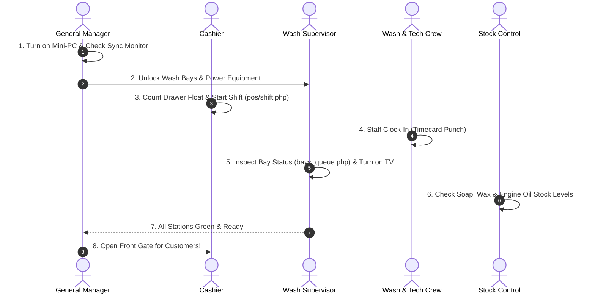

# 03. Daily Opening Routine
**Document Reference**: `docs/user_guide/03_DAILY_OPENING.md`  
**Target Audience**: Cashiers, Wash Supervisors, Technicians, Warehouse Lead, General Manager  
**Frequency**: Daily, 30 minutes before opening the customer gate.

---

## 1. The 30-Minute Opening Schedule

Opening the shop in a disciplined sequence guarantees that customer registers, cash drawers, washing equipment, and digital displays are operational before the first vehicle arrives.

---

## 2. Opening Routine by Role

### Role 1: Cashier Opening Routine (The Change Float)

- **Who does it**: Opening Cashier (e.g. `Dara`).
- **Where**: Counter POS Tablet & Back Office &rarr; **Shifts & Cash Control** (`index.php?view=shift`).
- **Objective**: Count physical starting cash float and officially open the POS register.

#### Step-by-Step Procedure:
1. **Power On Hardware**:
   - Turn on the counter POS tablet and receipt printer.
   - Verify green power light is illuminated on the thermal printer.
2. **Access Shift Screen**:
   - Log into the system using your personal 6-digit PIN.
   - Navigate to navigation menu **Shifts & Cash Control** *(វេនការងារ និងផ្ទេរប្រាក់)* or open the shift drawer prompt in the POS app.
3. **Count the Physical Starting Cash Float**:
   - Open the locked metal cash box provided by the manager.
   - Count the physical cash bills:
     - Count **US Dollars** (e.g., $1, $5, $10, $20 bills). Example float: `$50.00`.
     - Count **Cambodian Riel** (e.g., 500, 1000, 5000, 10000 notes). Example float: `100,000 KHR`.
4. **Submit Shift Start Form**:
   - In the **Start Shift** *(បើកវេនថ្មី)* card:
     - Enter **Opening Cash (USD)**: e.g. `50.00`.
     - Enter **Opening Cash (KHR)**: e.g. `100000`.
     - Enter **Starting Notes**: e.g. `Morning shift change float verified by Dara`.
   - Click **Open Shift / Start Day** *(ចាប់ផ្តើមវេនការងារ)*.
5. **Verify Status**:
   - The screen will transition to a green badge displaying: `Shift Active (វេនកំពុងដំណើរការ)`.
   - The POS register is now unlocked and ready to tender orders.

#### What Can Go Wrong & What to Do:
- *Problem*: The screen displays: *"Previous day is locked. Awaiting Manager Z-Report close"*.
- *Fix*: Call the General Manager. The previous night's close was incomplete. The manager must verify the previous night's closing cash before the new morning shift can open.

---

### Role 2: Wash Crew & Mechanic Clock-In (Timecard Attendance)

- **Who does it**: All car washers, detailing crew, and technical mechanics.
- **Where**: Staff Tablet at Bay or Back Office Top Navigation Bar.
- **Objective**: Record exact arrival time for payroll attendance, daily labor hours, and KPI calculations.

#### Step-by-Step Procedure:
1. Tap the **Time Clock** icon *(រូបនាឡិកា)* in the top navigation bar.
2. Enter your personal 6-digit PIN (e.g. `123456`).
3. Tap **Clock In** *(ចូលធ្វើការ)*.
4. The system registers:
   - Green indicator: `Clocked In at 07:55 AM`.
   - Your name appears on the active crew list for order task assignments.

#### What Can Go Wrong & What to Do:
- *Problem*: You forgot your PIN or the screen displays *"Account inactive"*.
- *Fix*: Immediately inform the General Manager or Owner. They can unlock your account and reset your temporary PIN in **Manage Staff** (`view=staff`). Do not wash cars under another worker's PIN, or your commissions will be credited to them.

---

### Role 3: Wash Supervisor Bay & Queue Inspection

- **Who does it**: Wash Supervisor (e.g. `Vannak`).
- **Where**: Bay Tablet &rarr; **Bays & Queue Board** (`index.php?view=bays_queue`).
- **Objective**: Ensure wash equipment is functioning, chemical tanks are full, and digital bay slots are cleared.

#### Step-by-Step Procedure:
1. **Physical Bay Walkthrough**:
   - Walk Bays 1, 2, and 3: Inspect high-pressure spray guns, foam cannons, water drainage grates, and air blower hoses.
   - Ensure clean, color-coded microfiber towels are stocked (Blue for glass, Yellow for body paint, Red for wheels).
   - Walk Bay 4 (Lube Bay): Verify the hydraulic car lift is lowered, waste oil drain cart is empty, and pneumatic air wrench line is pressurized.
2. **Digital Board Verification**:
   - Open **Bays & Queue Board** (`view=bays_queue`).
   - Verify all 4 bays display a green banner: `Free (ទំនេរ)`.
   - If a bay shows `Busy (រវល់)` from a test car from yesterday, tap the bay card &rarr; tap **Finish Job** *(បញ្ចប់ការងារ)* to clear the bay.
3. **Customer Waiting Room TV Setup**:
   - Power on the large TV in the waiting lounge with the remote control.
   - Verify the screen loads `http://<IP>/Car-WashService/tv.php`.
   - Confirm the live SSE stream indicator in the bottom corner shows a solid **Green Dot** *(Live Connected)*.

#### What Can Go Wrong & What to Do:
- *Problem*: TV shows a white screen or *"Cannot reach server"*.
- *Fix*: Check the Counter Mini-PC to confirm it is powered on and connected to the shop Wi-Fi network. Restart the TV browser or reload the page.

---

### Role 4: Stock Control Morning Inventory Check

- **Who does it**: Stock Control Lead (e.g. `Kosal`).
- **Where**: Warehouse PC &rarr; **Extras & Stock** (`view=extras`) and **Stock Ledger** (`view=stock_ledger`).
- **Objective**: Ensure sufficient soap chemicals, engine oil, and filters for projected daily volume.

#### Step-by-Step Procedure:
1. **Chemical Barrel Check**:
   - Inspect main 200L drums of concentrated car wash foam shampoo and protective liquid wax.
   - If a barrel has less than 20L remaining, prepare the backup drum and inform the manager.
2. **High-Turnover Engine Oil Check**:
   - Inspect Bay 4 oil rack: Ensure at least 6 sealed 4-liter jugs or tap lines of `0W-20` and `5W-30` synthetic engine oil are available.
3. **Inspect Low-Stock Alerts**:
   - Open **Extras & Stock** (`view=extras`).
   - Check if any items display the red badge: `Low Stock Alert` *(ជិតអស់ពីស្តុក)*.
   - If stock is critical, alert the General Manager so an emergency local supplier delivery can be arranged.

---

### Role 5: General Manager Morning System Verification

- **Who does it**: General Manager (e.g. `Sophea`).
- **Where**: Manager Laptop / Mini-PC &rarr; **Cloud Sync Monitor** (`index.php?view=sync_monitor`).
- **Objective**: Verify database health, review automated overnight backups, and confirm cloud data synchronization.

#### Step-by-Step Procedure:
1. **Check Cloud Sync Telemetry**:
   - Navigate to navigation menu **Cloud Sync Monitor** (`index.php?view=sync_monitor`).
   - Look at the top status card:
     - **Sync Status**: Must show green badge: `Online / Active`.
     - **Last Push**: Should be within the last 15 minutes.
     - **Unsynced Records**: Should be `0` or a very low number.
2. **Review Overnight Backup**:
   - Go to Settings &rarr; tab `system` (`view=settings&tab=system`).
   - Verify a new SQL backup file was automatically generated overnight (e.g. `CarWash_AutoBackup_2026-11-03.sql`).
3. **Check Cashier Drawer Float**:
   - Check in with the opening cashier.
   - Verify they have submitted their `$50.00` and `100,000 KHR` opening shift on the system.
4. **Authorize Opening**:
   - Give the signal to the front gate guard to open the driveway gates for customer vehicles!

---

## 3. Daily Opening Checklist (Printable Summary)

| Station / Task | Responsible Role | Target Time | Sign-off Check |
| :--- | :--- | :---: | :---: |
| 1. Counter Mini-PC and Wi-Fi router powered ON | General Manager | 07:30 AM | [&nbsp;&nbsp;] |
| 2. Cloud Sync Monitor shows `Online` | General Manager | 07:35 AM | [&nbsp;&nbsp;] |
| 3. Opening cash float counted and shift started | Cashier | 07:40 AM | [&nbsp;&nbsp;] |
| 4. Receipt printer loaded with 80mm paper roll | Cashier | 07:42 AM | [&nbsp;&nbsp;] |
| 5. All wash and mechanic staff clocked in on tablet | Wash & Tech Crew | 07:45 AM | [&nbsp;&nbsp;] |
| 6. Bays 1-3 inspected; clean towels and foam tanks ready | Wash Supervisor | 07:45 AM | [&nbsp;&nbsp;] |
| 7. Bay 4 hydraulic lift and oil drain verified | Mechanic Lead | 07:50 AM | [&nbsp;&nbsp;] |
| 8. Customer Lounge TV screen ON with green live dot | Wash Supervisor | 07:50 AM | [&nbsp;&nbsp;] |
| 9. Soap, wax, and engine oil inventory verified | Stock Control | 07:55 AM | [&nbsp;&nbsp;] |
| **10. Front Driveway Gate OPEN to Customers** | **General Manager** | **08:00 AM** | **[&nbsp;&nbsp;]** |
