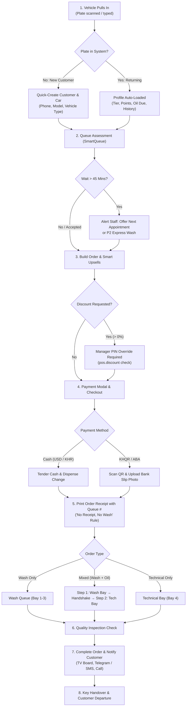

# 04. Customer Journey & Order Lifecycle (ដំណើការអតិថិជន និងការកុម្ម៉ង់)

This chapter guides you step-by-step through the entire customer journey from the second a vehicle pulls onto the apron until the keys are returned and the car drives away. It also covers special order variants such as mixed orders (wash + oil change), appointments, stock shortages, cancellations, and refunds.

---

## 1. Customer Journey Flowchart

---

## 2. Step-by-Step Walkthrough: From Arrival to Exit

### Step 1: Vehicle Arrival & License Plate Lookup
* **Who does it**: Cashier (អ្នកគិតលុយ)
* **Where**: POS Screen (`pos/index.html#pos` or Cashier POS)
* **What you see**:
  1. A large search bar at the top with a vehicle icon and keyboard shortcut (`F2`).
  2. A camera icon button next to it for camera plate scanning (where enabled).
  3. When typing a plate (e.g. `2A-1234`), a dropdown immediately shows matching cars, customer names, and current loyalty tiers.
* **Actions**:
  - **Returning Customer**: Click or tap the matching plate row. The customer's full name, phone number, vehicle type (e.g., SUV), tier badge (Bronze / Silver / Gold / VIP), accumulated loyalty points, and oil change reminder badge are loaded into the order header instantly.
  - **New Customer**: If no match is found, press **[+ New Customer]** (ចុះឈ្មោះអតិថិជនថ្មី). Enter:
    - Customer Name (e.g. `Sophea Chan`)
    - Phone Number (e.g. `012 345 678`)
    - License Plate (e.g. `2B-9876`)
    - Vehicle Type: Select Small Car, Medium Car, SUV, Pickup, Van, or Motorcycle. *(Crucial: This sets the correct washing pricing matrix and bay duration multiplier!)*
    - Tap **[Save Customer]** (រក្សាទុក).
* **What can go wrong and what to do**:
  - *Customer forgot their plate*: Search by customer phone number or customer name in the same search bar.
  - *Plate already registered to a previous owner*: Tap the car, edit the customer details, or register a new customer and link the existing plate with the customer's consent.

---

### Step 2: SmartQueue Wait Time Check & 45-Minute Appointment Prompt
* **Who does it**: Cashier
* **Where**: POS Screen — Smart Queue Widget & Queue Pill
* **What you see**:
  - Under the vehicle info, the **SmartQueueEngine** displays the real-time estimated wait time (e.g., `Est. Wait: 15 mins (2 cars ahead)`).
  - If all bays are packed and the queue exceeds **45 minutes**, the widget displays a high-contrast amber warning banner:
    `⚠️ Long Queue Notice: Estimated wait is 55 minutes.`
* **Actions**:
  - When the wait exceeds 45 minutes, staff must verbally inform the customer:
    *"Dear customer, our bays are currently busy with a 55-minute queue. We can book a guaranteed VIP slot for you later today or tomorrow, or upgrade you to P2 Express if urgent."*
  - To book an appointment, navigate to **Appointments** (`/appointments`), pick a date and hour slot, and reserve the slot.
  - If the customer agrees to wait, proceed with order entry.

---

### Step 3: Order Builder & Smart Upsells
* **Who does it**: Cashier
* **Where**: POS Screen — Category Grid & Cart Panel
* **What you see**:
  - Categories on the left: **Wash & Detailing** (លាង និងប៉ូលា), **Technical & Oil** (ប្តូរប្រេង និងជួសជុល), **Beverages & Retail** (ភេសជ្ជៈ និងទំនិញ).
  - Services automatically show the correct price matching the selected vehicle type (e.g., Premium Wash SUV = $8.00).
  - **Smart Upsell Prompt**:
    - If the customer selected a Basic Wash, the system suggests: *"Add Premium Tire Wax for +$2.00"* or *"Interior Ozone Sterilization for +$3.00"*.
    - If the vehicle's odometer is within 500 km of its scheduled oil change (or past due), a red alert tag appears: `🛢️ Oil Change Due! Recommended: Total Quartz 9000 5W-30`.
* **Actions**:
  1. Tap the desired service cards to add them to the right-hand cart.
  2. Offer the suggested upsell verbally. If accepted, tap the upsell badge to add it to the ticket. The system logs this upsell acceptance for staff commission reporting.
  3. Verify quantities and service items in the cart table.

---

### Step 4: Discounts & Manager PIN Override
* **Who does it**: Cashier & Manager (អ្នកគ្រប់គ្រង)
* **Where**: POS Screen — Cart Action Pill **[Discount]** (`#btnCartPillDiscount`)
* **What you see**:
  - Modal pops up allowing Percentage (`%`) or Fixed Dollar (`$`) discount, plus quick buttons (5%, 10%, 15%, 20%).
  - If customer has an active membership tier with automatic discount (e.g., Gold Tier 10% Wash Discount), the system applies it automatically without requiring manager intervention.
* **Rules & Permissions**:
  - **Cashier has no permission to grant custom discounts.** (The permission `pos.discount` is reserved for Manager and Owner).
  - When a manual discount > $0.00 is entered, the screen prompts for **Manager Authorization**:
    `Manager PIN Required to approve $2.00 discount.`
* **Actions**:
  1. Cashier calls the Shift Manager.
  2. Manager inspects the cart reason, selects their name from the manager dropdown, and keys in their **Manager PIN**.
  3. The discount is applied, recalculating total USD and KHR. An immutable entry is written to `audit_logs`.
* **What can go wrong and what to do**:
  - *Manager enters wrong PIN*: The POS shows `Error: Invalid Manager PIN`. The discount is discarded.
  - *Discount exceeds total amount*: Blocked by system with error `DISCOUNT_EXCEEDS_TOTAL`.

---

### Step 5: Payment Processing & Bank Slip Verification
* **Who does it**: Cashier
* **Where**: POS Screen — **[Charge / បង់ប្រាក់]** (`#btnOpenCheckout`)
* **What you see**:
  - Total payable displayed prominently in both **USD** and **KHR** (using current shop exchange rate, e.g., $10.00 = 41,000 ៛).
  - 3 Payment Tabs:
    1. **Cash (សាច់ប្រាក់)**
    2. **ABA Pay**
    3. **KHQR ស្កេន**
* **Payment Procedures**:

#### Option A: Cash Payment
1. Select the **Cash** tab.
2. Enter the amount handed by customer using the numerical keypad or tap quick bill buttons (`$5`, `$10`, `$20`, `$50`, `20,000៛`, `50,000៛`, or **[Exact Amount]**).
3. The screen immediately calculates and displays the change in both USD and KHR.
4. Tap **[Complete Cash Payment]** (បញ្ចប់ការទូទាត់). The cash drawer opens automatically via printer kick-pulse. Cashier places money in drawer and hands back exact change.

#### Option B: ABA Pay / Bank Transfer
1. Select the **ABA Pay** tab.
2. The shop's verified ABA Merchant Account Number and Account Name are displayed.
3. Ask customer to transfer the exact amount and show their phone screen.
4. Type the **Transaction Reference Number** (e.g., `789456`) into the `Ref #` field.
5. Tap **[Upload Bank Slip Photo]** (`#bankSlipFileInput`). Cashier snaps a clear photo of the customer's transfer confirmation screen using the tablet/webcam.
6. Tap **[Confirm Transfer Payment]**.

#### Option C: KHQR Dynamic Scan
1. Select the **KHQR** tab.
2. A high-contrast Bakong-compliant KHQR code appears on the screen (or on the customer-facing secondary display).
3. The customer opens any Cambodian banking app (ABA, ACLEDA, Sathapana, Wing, Canadia, etc.) and scans the code.
4. Cashier confirms the funds received notification on the shop's notification device.
5. Tap **[Upload Bank Slip Photo]** and snap a photo of the successful confirmation screen.
6. Tap **[Complete KHQR Payment]**.

* **What can go wrong and what to do**:
  - *Banner "No bank account saved" appears*: Owner must configure bank details in Back Office Settings (`/settings?tab=bank`) before ABA/KHQR can be used.
  - *Photo slip is blurry*: Always retake the photo. In spot audits and day-end reconciliation, missing or illegible bank slips are treated as cash shortages charged to the cashier.

---

### Step 6: Receipt Printing ("No Receipt, No Wash" Rule)
* **Who does it**: Cashier & Customer
* **Where**: Receipt Printer (`port 1818` or thermal print modal)
* **What you see**:
  - A receipt prints instantly upon payment completion.
  - The receipt contains:
    1. Shop Header, Logo, Address, and Phone numbers.
    2. Large bold **Queue Number** (e.g., `Q-014`).
    3. License Plate (e.g., `2A-1234`) and Vehicle Type.
    4. Itemized list of services & products with prices in USD and KHR.
    5. Payment method, cashier name, date/time timestamp.
    6. Customer barcode / QR code for queue tracking.
    7. Membership tier status and updated points balance.
* **Strict Rule**:
  > [!IMPORTANT]
  > **THE "NO RECEIPT, NO WASH" RULE**:
  > Washers and technicians are strictly forbidden from touching any vehicle without a printed receipt sitting on the dashboard or handed to them. This guarantees that every car washed has been registered and paid for in the system.

---

### Step 7: Queue Allocation & Bay Assignment
* **Who does it**: Wash Supervisor (ប្រធានផ្នែកលាង) or Auto-Bay Engine
* **Where**: Wash Bay Monitor (`/bays` or `views/washer/bays.php`)
* **What you see**:
  - The vehicle appears in the **Waiting Queue** column as `Q-014 | 2A-1234 (SUV)`.
  - The SmartQueueEngine calculates bay recommendation scores based on bay capability (e.g. Bay 1 has high-pressure undercarriage wash) and technician completion time.
* **Actions**:
  1. The Supervisor drags or assigns the car into an empty bay (e.g. **Bay 2**).
  2. The washer assigned to Bay 2 taps **[Start Job]** (ចាប់ផ្តើម). The status updates to `Washing` (កំពុងលាង), and the elapsed countdown timer begins.
  3. The Waiting Lounge TV (`tv.php`) immediately moves `2A-1234` from "Waiting" to "In Progress — Bay 2".

---

### Step 8: Quality Inspection Check & Handover
* **Who does it**: Wash Supervisor / Mechanic & Cashier
* **Where**: Bay Monitor / Order Detail Screen
* **What you see**:
  - 4-point Quality Check checklist on tablet:
    - [x] Wheels & tire shine clean
    - [x] Windows streak-free inside & out
    - [x] Dashboard vacuumed and wiped
    - [x] Mirrors & door jambs dry
* **Actions**:
  1. Supervisor reviews vehicle, checks off items, and taps **[Mark Finished]** (បញ្ចប់ការងារ).
  2. Order status turns to `finished` (រួចរាល់).
  3. TV screen moves vehicle to **"Ready for Pick-up"** (រួចរាល់) with audio chime.
  4. If customer provided mobile/Telegram, an automatic notification is triggered:
     *"Your vehicle 2A-1234 is ready for pick-up! Thank you for choosing us."*
  5. Cashier hands keys to the customer, thanks them, and vehicle departs.

---

## 3. Order Variants & Exceptions

### Variant A: Mixed Order (Wash + Oil Change)
A mixed order includes both cleaning services and mechanical maintenance on the same vehicle ticket.

* **How the system handles it**:
  1. When cashier adds a Wash service and an Oil Change service/product to the same cart, `orders.is_mixed` is automatically flagged as `1`.
  2. The system splits the order into two sequential child tasks in `order_tasks`:
     - **Task 1: Wash Task** (Assigned to Wash Bay / Washer).
     - **Task 2: Mechanical Task** (Assigned to Tech Bay / Mechanic).
  3. **The Handshake Protocol**:
     - Vehicle is washed first in Bay 1.
     - When the washer clicks **[Finish Wash Task]**, the system does NOT release the vehicle to the customer.
     - Instead, the Bay Manager sends an audio and visual alert to the Technical Bay:
       `🔔 Vehicle 2A-1234 wash completed. Ready for transfer to Tech Bay.`
     - Mechanic accepts transfer, drives vehicle into Technical Bay 4, and clicks **[Start Mechanical Task]**.
     - Mechanic records new oil mileage, replaces oil & filter, and marks the task complete.
     - Only when both child tasks are completed does the master order turn to `finished`.

---

### Variant B: Appointment Arrival
* **How it works**:
  1. Customer arrives at the apron stating they have a 10:00 AM appointment.
  2. Cashier types license plate into POS.
  3. System matches plate with today's appointments table.
* **On-Time Rule (SmartQueueEngine)**:
  - If customer arrives within **+/- 10 minutes** of scheduled time:
    - Vehicle is assigned **Priority P0 (VIP Appointment)** with green badge.
    - Customer is placed at the head of the waiting line ahead of walk-in vehicles.
* **Late Arrival Rule**:
  - If customer arrives **more than 10 minutes late**:
    - System automatically demotes priority from P0 to **P3 (Walk-in)** with badge `P3 Walk-in (Late Appt +22m)`.
    - Customer takes the next available slot in normal queue order without bumping on-time customers.

---

### Variant C: Out-of-Stock Item During Technical Job
* **What happens**:
  1. Mechanic inspects car in Bay 4 and discovers the customer's vehicle requires a specialized synthetic oil or specific filter not pre-billed at POS.
* **Workflow**:
  1. Mechanic opens Technical Bay screen (`/mechanic/jobs`), taps **[Request Parts]** (`parts_requests`).
  2. Selects requested part and quantity.
  3. Order state automatically pauses and SmartQueue flags the vehicle delay reason as:
     `Waiting for part approval` (SmartQueue delay detection).
  4. Warehouse staff receives pop-up notification, verifies stock shelf, approves release, and hands part to mechanic.
  5. Cashier adds the supplement to the customer's bill or processes supplemental payment at pickup.

---

### Variant D: Order Cancellation (Before Work Commences)
* **Conditions**: Vehicle is waiting in line; work has not started (`washing` has not begun). Customer decides to leave due to urgent errand.
* **Permission**: Cashier CANNOT cancel independently. Requires `pos.cancel_order` / `orders.cancel`.
* **Step-by-Step**:
  1. Open Order Details modal on POS or Orders screen (`/orders`).
  2. Click **[Cancel Order]** (បោះបង់ការបញ្ជាទិញ).
  3. System prompts for **Manager PIN** and **Reason for Cancellation** (mandatory).
  4. Manager enters credentials and reason (e.g. `Customer had emergency appointment`).
  5. System:
     - Sets `orders.status = 'cancelled'`.
     - Releases reserved warehouse parts back to available stock.
     - Reverses any awarded loyalty points.
     - Writes immutable entry to `audit_logs`.

---

### Variant E: Refund After Payment
* **Conditions**: Customer paid, but an issue occurred (e.g., equipment power outage, or customer dissatisfied with service after inspection).
* **Security Rules**:
  - `STAFF_REQUIRED`: Cashier staff ID must be recorded.
  - `MANAGER_PIN`: Mandatory manager authorization on screen.
  - `NO OFFLINE REFUNDS`: Refunds are **strictly blocked when the POS is offline** (`is_offline = true`) to prevent offline fraudulent double-refunding.
* **Step-by-Step**:
  1. Open Orders List (`/orders`), locate paid order, and select **[Process Refund]** (`#btnProcessRefund`).
  2. Enter **Refund Amount** in USD (full or partial).
  3. Enter **Refund Reason** (e.g. `Customer scratch claim settled` or `Bay breakdown`).
  4. Select authorizing manager and type **Manager PIN**.
  5. System validates manager credentials against database.
  6. Upon approval:
     - Order status updates to `refunded`.
     - Cash is disbursed from register drawer (or reversed to bank).
     - Shift cash drawer balance is decremented by refund amount.
     - Full audit trail recorded in `audit_logs`.
