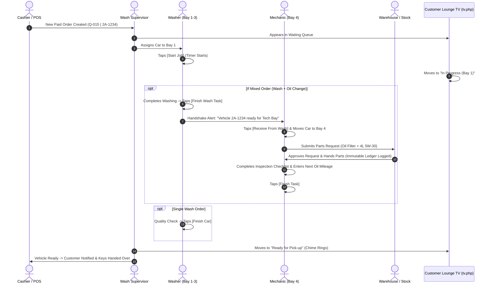
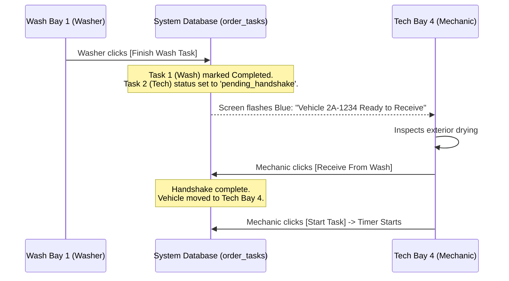

# 05. Shop Floor & Bay Operations (ប្រតិបត្តិការរោងជាង និងកន្លែងលាង)

The shop floor is where physical operations happen. The system coordinates the wash bays, technical/mechanic bays, warehouse stock release, and the customer lounge TV in real time.

---

## 1. Shop Floor Role Architecture

---

## 2. Wash Supervisor View (`views/owner/bays_queue.php`)

* **Who uses it**: Wash Supervisor (ប្រធានផ្នែកលាង), Shop Manager, or Owner.
* **Where**: Tablet or PC in the supervisor office or apron desk (`/bays_queue` or menu **Wash Area &rarr; Bays & Queue Monitor**).
* **Key Features on Screen**:
  1. **Active Bays Monitor**: Cards for each physical bay (Bay 1, Bay 2, Bay 3, etc.) displaying:
     - Current occupying vehicle (Queue #, Plate, Model, Vehicle Type).
     - Assigned washer personnel (e.g. `Rathana & Sokha`).
     - Elapsed timer vs estimated duration with progress bar.
     - Amber/Red highlight if elapsed time exceeds estimated duration.
  2. **Waiting Line (Queue) Table**:
     - Lists all vehicles waiting on the apron in order of priority (`P0 VIP`, `P1 Member`, `P2 Express`, `P3 Walk-in`).
     - Real-time estimated wait time calculated by `SmartQueueEngine`.
  3. **Queue Control Actions**:
     - **Assign to Bay**: Select an open bay from the dropdown and click **[Assign]**.
     - **Reassign Bay**: Drag or change a car to a different bay if equipment requires maintenance.
     - **Change Queue Position**: Drag a car up or down in line if a customer stepped away or requested a delay.
     - **Set Delay Reason**: If a car is delayed (e.g., heavy mud underbody requiring extensive degreasing), click **[Delay Reason]** and pick from the standardized list (or type a custom reason). This updates the TV board so customers understand why work is taking longer.
     - **Long Queue Alert**: If total estimated wait exceeds **45 minutes**, a prominent alert flashes on screen advising staff to throttle walk-ins or offer appointments.

---

## 3. Washer View (`views/washer/jobs.php`)

* **Who uses it**: Wash Bay Team / Washers (បុគ្គលិកលាងរថយន្ត).
* **Where**: Wall-mounted waterproof tablet or mobile phone stationed at each bay (`/washer/jobs` or menu **Washer Screen**).
* **Screen Layout & Workflow**:
  1. **My Assigned Bay & Vehicle Card**:
     - Shows the car currently in the bay: Plate (e.g. `2A-1234`), Color, Make/Model, and Service Package (e.g. `Premium Foam Wash + Undercarriage Spray`).
     - Displays special customer notes (e.g., *"Do not spray fragrance inside"*).
  2. **Starting the Wash**:
     - When the car enters the bay, tap **[Start Job]** (ចាប់ផ្តើម).
     - The timer turns green and begins counting up from `00:00`.
  3. **During Washing**:
     - Screen displays the remaining minutes countdown based on the vehicle size multiplier (e.g. SUV = 25 minutes).
     - If the wash takes longer than expected, the washer can select a reason:
       - *Heavy soil - extra rinse*
       - *Customer requested extra interior vacuum*
       - *Tree sap / water spot removal*
  4. **Finishing the Wash**:
     - After drying and final inspection, tap **[Finish Car]** (បញ្ចប់ការងារ).
     - If the order is a standard wash, it immediately notifies the cashier and updates the customer TV board to "Ready for Pick-up".
     - If the order is a mixed order, the system initiates the **Handshake Protocol** (see Section 5 below).

---

## 4. Mechanic / Technical View (`views/mechanic/jobs.php`)

* **Who uses it**: Lead Mechanic, Technician (ជាងជួសជុល), Technical Supervisor.
* **Where**: Ruggedized tablet or workshop terminal at Technical Bay 4 (`/mechanic/jobs` or menu **Technical Screen**).
* **Key Sections & Features**:

### A. Digital Inspection Checklist (12-Point Multi-Point Check)
Mechanics perform structured checks before and during service. The checklist covers:
- [x] Engine oil level and color
- [x] Brake fluid level and moisture percentage
- [x] Coolant level and radiator condition
- [x] Tire pressure (PSI) and tread depth (mm)
- [x] Battery voltage and terminal corrosion
- [x] Air filter and cabin A/C filter cleanliness
- [x] Wiper blades and windshield washer fluid
- [x] Suspension / underbody leaks

Tapping an item toggles its status: **Pass (បៃតង)**, **Attention Required (លឿង)**, or **Urgent Hazard (ក្រហម)**. Mechanics can attach technical notes.

### B. Oil Change & Maintenance Recording (`adjust_oil`)
When completing an oil service:
1. Tap **[Record Oil & Mileage]**.
2. Enter:
   - **Current Vehicle Odometer** (e.g., `85,200 km`).
   - **Oil Brand & Viscosity Used** (e.g., `Total Quartz 9000 5W-30 Synthetic`).
   - **Actual Volume Dispensed** (e.g., `4.2 Liters`).
   - **Next Oil Service Due Mileage** (automatically calculated: `85,200 + 7,000 = 92,200 km`, or custom).
   - **Next Oil Service Due Date** (default 6 months ahead).
3. Tap **[Save Oil Record]**. The system saves this data to `vehicle_history` and automatically updates the customer's next oil change reminder date.

---

## 5. The Handshake Protocol (Wash &rarr; Technical Handover)

When a customer orders both a wash and a technical service (e.g., Basic Wash + Engine Oil Change), the vehicle must flow smoothly between two physical teams without losing track of accountability.

* **Step 1: Wash Completion**: Washer completes exterior/interior cleaning in Bay 1 and taps **[Finish Wash Task]**.
* **Step 2: Alert at Technical Bay**: The Technical Bay screen displays a blue alert box with vehicle details and plate number:
  `🔔 Vehicle 2A-1234 (SUV) wash completed. Waiting for transfer to Technical Bay.`
* **Step 3: Transfer & Acceptance**: The mechanic drives the car onto the lift in Technical Bay 4 and taps **[Receive From Wash]** (`action=receive_from_wash`).
* **Step 4: Accountability Handover**: The system logs the exact timestamp and user IDs. If a delay occurs between wash completion and mechanical start, the audit log clearly records whose bay the car was in.

---

## 6. Warehouse Parts Request & Release Workflow

Mechanics must never take oils, filters, or spare parts from storage shelves without digital recording. Every part must be accounted for in the immutable stock ledger.

### Step 1: Mechanic Submits Parts Request
1. On the job card in `views/mechanic/jobs.php`, tap **[Request Parts]** (`action=request_parts`).
2. Select the part from the catalog dropdown (e.g., `Oil Filter - Toyota Vios (Part #OF-90915)`).
3. Enter requested quantity (e.g. `1`).
4. Tap **[Submit Parts Request]**.
5. The order status in SmartQueue automatically updates to **"Waiting for part approval"**, preventing overdue penalties against the mechanic while waiting for inventory.

### Step 2: Warehouse Staff Verification & Issuance
1. The Warehouse / Stock Controller opens **Stock Control &rarr; Parts Requests** (`/owner/stock_ledger` or parts queue).
2. The controller verifies physical stock on shelf against the request.
3. Taps **[Approve & Issue]** (យល់ព្រមចេញទំនិញ).
4. Physical part is handed to the mechanic.

### Step 3: Automated Ledger Deductions
The system immediately:
- Decrements the available stock count in the `products` table.
- Writes an append-only transaction into `stock_movements`:
  `Type: out | Qty: -1 | Ref: Order #1042 | Balance: 14 units | Staff: stock_user`.
- If remaining stock falls below the product's `reorder_level`, an alert badge appears on the Manager Dashboard.

---

## 7. Customer Waiting Lounge TV (`tv.php`)

The TV display runs in the customer waiting lounge on a smart TV browser (Chrome / Android TV) or mini-PC connected via HDMI.

* **URL**: `http://<shop-ip>/Car-WashService/tv.php?code=<tv_secret_code>`
* **Screen Sections**:
  1. **Header**: Shop name, current date, live digital clock, and shop telephone number.
  2. **Active Bays Grid (Top)**: Cards showing each bay, vehicle queue number, masked license plate (e.g., `2A-•••4` for privacy), vehicle model, and service status.
  3. **Waiting in Queue (Bottom Left)**: List of cars waiting in line with their queue numbers and approximate wait times.
  4. **Ready for Pick-up (Bottom Right)**: High-contrast green glowing cards for vehicles that have finished all services and are ready for owner collection.
* **Live Updates (SSE)**:
  - Uses **Server-Sent Events** (`api/queue_stream.php`) to push queue updates instantly without screen flickering or full-page reloading.
  - Built-in resilience: If the network drops, it automatically retries 3 times and gracefully falls back to background HTTP polling every 5 seconds.
* **Audio Alerts**:
  - When any vehicle transitions from `washing` or `working` to `finished`, the TV plays an audible notification chime to alert relaxing customers.

---

## 8. Duration Feedback & Continuous Learning Reviews

The system continuously measures real-world workshop speed to keep customer wait time estimates accurate.

1. **Duration Measurement**:
   - Every service has a catalog `base_duration_minutes` (e.g., 20 mins) adjusted by the `vehicle_multiplier` (e.g., SUV = 1.25x = 25 mins).
   - When the job starts, `started_at` is stamped; when finished, `actual_duration_minutes` is calculated.
2. **The 20% Overrun Threshold**:
   - If a job takes **more than 20% longer** than the estimate (e.g., estimated 25 mins, but took 33 mins), or if staff flagged "Took longer than expected":
   - The system automatically logs the event into `service_duration_reviews`.
3. **Manager Review & Calibration**:
   - Managers review these exceptions weekly in Back Office Settings &rarr; Duration Calibration.
   - Manager can inspect the recorded reasons (e.g., "Underbody degreaser needed for 5 consecutive SUVs").
   - Manager choices:
     - **Accept & Recalibrate**: Permanently update the catalog service base duration from 20 mins to 25 mins.
     - **Dismiss**: Retain the existing duration (e.g., if delay was caused by temporary staff shortage or equipment maintenance).
