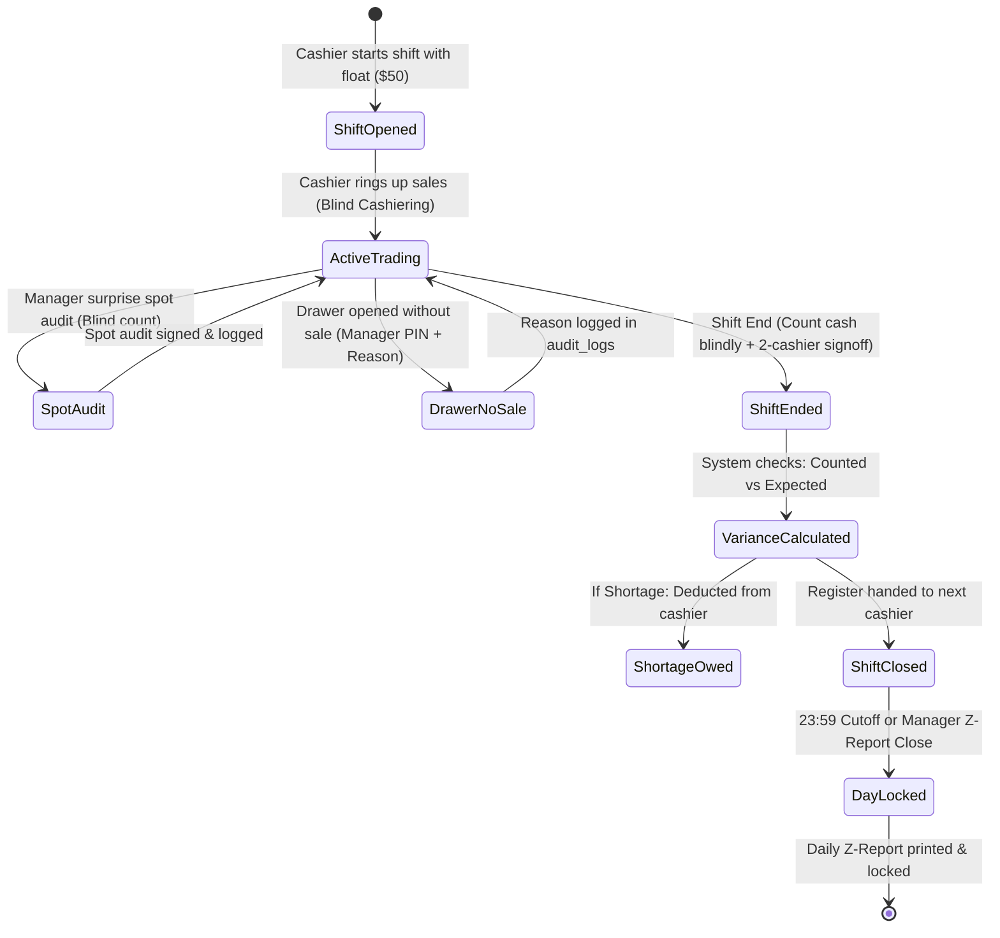

# 06. Money, Shifts, and Cashier Controls (ការគ្រប់គ្រងលុយ វេន និងសុវត្ថិភាព)

This chapter covers the financial rules, shift procedures, blind cashiering, spot audits, day closing, and fraud prevention measures built into the system.

---

## 1. Shift & Day Lifecycle

---

## 2. Shift Opening & Opening Float (មូលនិធិដើមវេន)

* **Who does it**: Incoming Cashier (អ្នកគិតលុយវេនថ្មី)
* **Where**: Cashier Shift Screen (`/shift` or menu **Cashier &rarr; Shift Management**)
* **Step-by-Step Procedure**:
  1. Cashier logs into their POS terminal with their 6-digit PIN.
  2. Navigate to **Shift Management** (`views/cashier/shift.php`).
  3. If no shift is open, the screen displays **"Start New Shift"** (ចាប់ផ្តើមវេនថ្មី).
  4. Physically count the starting change fund (opening float) in the physical cash drawer.
  5. Enter:
     - **Opening Cash USD** (e.g. `$50.00`)
     - **Opening Cash KHR** (e.g. `200,000 ៛`)
     - Optional shift opening notes (e.g., `Drawer in good condition; rolls of 1,000៛ replenished`).
  6. Tap **[Start Shift]** (ចាប់ផ្តើមវេន).
  7. The system creates an active shift record in `cashier_shifts` and logs `SHIFT_START` with timestamp and device ID.

---

## 3. Blind Cashiering: The Anti-Fraud Pillar

### What is Blind Cashiering?
In many traditional shops, cashiers can see a running total on screen saying: *"You currently have $345.50 in your cash drawer."* 

**This system strictly hides that total from the cashier during their shift.**

### Why Blind Cashiering is Critical for Business Owners:
1. **Prevents "Pocketing the Buffer"**: If a cashier knows the computer expects $340, but through an over-collection or tip there is $360 in the drawer, a dishonest cashier will pocket the $20 difference before clocking out.
2. **Enforces Genuine Counting**: At shift end, the cashier cannot simply copy the computer's number onto the handover paper. They are forced to physically count every bill and coin.
3. **Catches Unentered Sales**: If a cashier washed a friend's car without entering an order, or pocketed cash from an unreceipted wash, the physical cash will not match the blind system audit.

---

## 4. Shift Handover & Two-Cashier Sign-Off

At the end of a shift (e.g., Morning Shift handing over to Evening Shift), both cashiers must stand together at the counter.

### Step-by-Step Handover:
1. **Outgoing Cashier Blind Cash Count**:
   - Outgoing cashier opens **Shift Management &rarr; End Shift**.
   - Cashier physically counts the cash in the drawer and types:
     - **Counted Cash USD** (e.g. `$285.00`)
     - **Counted Cash KHR** (e.g. `140,000 ៛`)
   - Cashier enters their **Outgoing Cashier PIN** to sign that this was their true count.
2. **Incoming Cashier Verification**:
   - Incoming cashier double-checks the physical cash bills.
   - Incoming cashier selects their name and enters their **Incoming Cashier PIN**.
3. **Instant System Reconciliation**:
   The system runs the strict formula:
   $$\text{Expected Cash} = \text{Opening Float} + \text{Cash Sales} - \text{Cash Expenses} - \text{Cash Refunds}$$
   The screen instantly displays the financial summary:
   - Total Cash Sales: `$240.00`
   - Minus Drawer Expenses: `-$5.00` (Ice purchase for staff)
   - Minus Cash Refunds: `$0.00`
   - Plus Opening Float: `+$50.00`
   - **Expected Total**: `$285.00`
   - **Counted Total**: `$285.00`
   - **Difference / Variance**: `$0.00` (Balanced / ត្រឹមត្រូវ)

---

## 5. The Cash Shortage Rule (វិធានការខ្វះលុយ)

If physical cash is less than expected cash:
* **The Variance Formula**:
  $$\text{Difference} = \text{Counted Cash} - \text{Expected Cash}$$
* **When Difference is Negative** (e.g., Counted `$270.00`, Expected `$285.00` = `-$15.00`):
  1. The system flags the shift in bold red as **SHORTAGE** (ខ្វះលុយ).
  2. The deficit amount is saved in `cashier_shifts.shortage_owed_usd`.
  3. An immutable alert is written to `audit_logs` under action `SHIFT_SHORTAGE`:
     `Cash shortage of $15.00 recorded as owed by Cashier Sokha (#4)`.
  4. **Standard Shop Policy**: The outgoing cashier must reimburse the shortage immediately or have the amount deducted from their month-end salary.
* **When Difference is Positive (Surplus)**:
  - If counted cash exceeds expected cash (e.g., `+$5.00`), the excess is retained in the shop account and recorded as overage. It is never pocketed by staff.

---

## 6. Unannounced Spot Audits (ការធ្វើអធិការកិច្ចសាច់ប្រាក់ភ្លាមៗ)

* **Who does it**: Shop Manager or Owner (អ្នកគ្រប់គ្រង ឬ ថៅកែហាង)
* **Where**: POS or Back Office &rarr; **Cashier Shifts &rarr; Spot Audit** (`/shift`)
* **When to perform**: At unpredictable times during busy hours (e.g., 2:30 PM on a Saturday).
* **Procedure**:
  1. Manager walks up to the cashier desk and announces: *"Please step aside for a spot audit."*
  2. Cashier counts all physical cash in the drawer under manager supervision.
  3. Manager opens the **Spot Audit** panel on screen.
  4. Enters:
     - Cashier being audited.
     - Cashier's counted USD and KHR.
     - Manager's username and **Manager PIN**.
  5. System calculates the real-time expected cash up to that exact minute.
  6. Results display immediately:
     - Expected Cash: `$180.00`
     - Counted Cash: `$180.00`
     - Difference: `$0.00`
  7. If there is a discrepancy, the manager addresses it immediately while customers and tickets are fresh.

---

## 7. No-Sale Drawer Openings (ការបើកថតលុយដោយគ្មានការលក់)

The physical cash drawer should only open automatically when a valid cash receipt is printed. Opening the cash drawer without a sale is a primary vector for skimming and unauthorized bill exchange.

* **When is No-Sale permitted?**
  - Making change for a customer or neighbor vendor.
  - Adding emergency small change (bills of 1,000៛ / 2,000៛) to the drawer.
* **Strict Control**:
  1. On POS, tap **[Open Drawer / No Sale]**.
  2. Cashier must enter a **Mandatory Reason** (e.g., *"Customer needed change for 100-dollar bill"*).
  3. Cashier selects authorizing manager and manager enters **Manager PIN**.
  4. Drawer pulse triggers.
  5. The event is permanently recorded in `drawer_events` and `audit_logs` (`DRAWER_OPEN_NO_SALE`).
  6. The daily Z-report lists the exact count of No-Sale openings. Any cashier with excessive No-Sale openings is investigated.

---

## 8. Bank Transfer & KHQR Verification

Digital payments via ABA and KHQR are safe from physical robbery, but vulnerable to customer fraud (e.g., showing a fake screenshot or photoshopped transaction receipt).

* **The Two-Step Verification Rule**:
  1. **Bank Reference Number Entry**: Cashier must type the transaction reference number (`Ref #`) into the POS payment modal.
  2. **Mandatory Bank Slip Photo Upload**:
     - Cashier taps the camera icon in the payment modal (`#bankSlipFileInput`).
     - Snaps a clear, readable photo of the customer's successful transfer screen or paper slip.
     - The image is saved in the local server media store linked to the order ID.
* **Owner Daily Bank Reconciliation**:
  - In Back Office &rarr; **Orders**, owners can click the bank icon on any digital order to view the attached slip photo alongside the transaction reference.
  - Owner compares total daily ABA/KHQR sales against their mobile banking app daily inflow statement.

---

## 9. Day Close & Z-Report (ការបិទបញ្ជីប្រចាំថ្ងៃ និងរបាយការណ៍ Z)

At the end of the operating day, the shop must officially close the business day and lock financial accounts.

* **Who does it**: Shop Manager or Owner (Requires `cashier.close_day` / `manager` role).
* **Where**: Shift Management Screen &rarr; **Close Day (Z-Report)**.
* **Step-by-Step Procedure**:
  1. Ensure all active cashier shifts have been closed via shift handover.
  2. Ensure all bays are clear and all orders are either `paid` or `cancelled`.
  3. Count total final cash in the main safe/register.
  4. Navigate to **Close Day & Z-Report**.
  5. Enter:
     - **Counted Cash USD** and **KHR**.
     - Manager Username & **Manager PIN**.
     - Day closing remarks.
  6. Tap **[Generate Final Z-Report & Lock Day]**.
  7. The thermal printer prints the official **Daily Z-Report**:
     - Gross Sales (USD & KHR)
     - Breakdown by Payment Method: Cash, ABA Pay, KHQR
     - Discounts granted (and authorizing managers)
     - Petty Cash Expenses paid from drawer
     - Total Refunds processed
     - Net Expected Cash vs Net Counted Cash
     - Grand Cash Variance
  8. Daily sales counters reset to zero for tomorrow's business day.

---

## 10. Day Lock & The 23:59:01 Automatic Cutoff

To prevent staff from ringing up unauthorized sales after-hours, the system enforces automated day locking.

* **Automatic Cutoff at 23:59:00**:
  - Exactly at 11:59 PM, `CashierControl::isDayLocked()` activates automatically.
  - POS registers will refuse to process new orders or tender payments.
  - Any screen attempt displays:
    `⚠️ Sales are automatically locked at 11:59 PM. Manager PIN required to close the day.`
* **Unlocking a Closed Day**:
  - Once closed via Z-report, the day cannot be reopened by cashiers.
  - In exceptional situations where an emergency fleet wash arrives at midnight, an Owner or Manager can unlock the register by providing their PIN and entering a mandatory audit justification.

---

## 11. Immutable Audit Log Trail (`views/owner/audit_logs.php`)

Every single high-risk operational action writes an unalterable log record:

| Action Code | Trigger Event | Details Logged |
|---|---|---|
| `SHIFT_START` | Cashier opens register | Staff ID, Cashier Name, Opening Float USD/KHR, Device ID |
| `SHIFT_HANDOVER` | Two-cashier shift change | Outgoing & Incoming staff names, Counted vs Expected, Variance |
| `SHIFT_SHORTAGE` | Shift ends with cash deficit | Exact deficit amount owed by cashier |
| `SPOT_AUDIT` | Manager surprise audit | Cashier name, Manager name, Discrepancy amount |
| `DRAWER_OPEN_NO_SALE`| Cash drawer popped without sale | Cashier name, Authorizing manager name, Justification reason |
| `MANAGER_REFUND` | Cash or digital refund issued | Order #, Refund amount, Manager PIN used, Refund reason |
| `POS_DISCOUNT` | Manual price reduction | Order #, Discount amount/percent, Approving manager |
| `DAY_CLOSE_Z_REPORT` | Business day officially closed | Total sales, Net cash, Over/Short variance, Closing manager |
| `STOCK_ADJUSTMENT` | Manual inventory change | Product, previous count, new count, Reason note |

> [!TIP]
> **Owner Daily Routine**: Spend 3 minutes every morning scanning the **Audit Logs** (`/owner/audit_logs`). Filter by `MANAGER_REFUND`, `DRAWER_OPEN_NO_SALE`, and `SHIFT_SHORTAGE` to keep a finger on store security.
