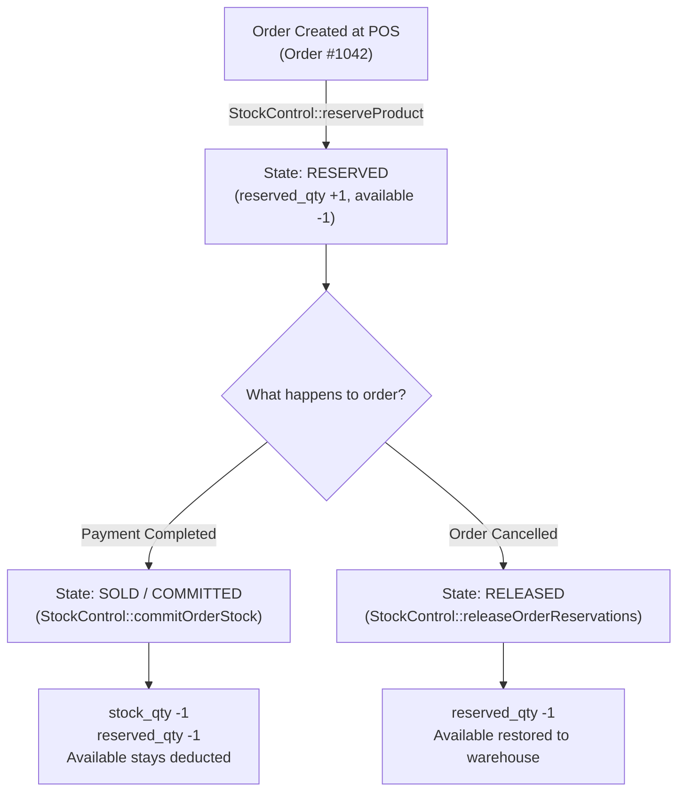

# 07. Stock, Warehouse, and Product Inventory (ការគ្រប់គ្រងឃ្លាំង និងទំនិញ)

This chapter explains how the workshop tracks physical products, lubricants, spare parts, and retail items using the system's **Immutable Stock Ledger**.

---

## 1. Services vs. Products: The Fundamental Distinction

In this system, items sold to customers fall into two distinct catalogs:

| Type | Examples | Stock Tracking | Pricing Matrix |
|---|---|---|---|
| **Services (សេវាកម្ម)** | Basic Wash, Detailing, Foam Wash, Labor | **No physical inventory**. Bounded only by workshop bay time. | Dynamic pricing based on **Vehicle Type** (Small, SUV, Van, etc.). |
| **Products (ទំនិញ / គ្រឿងបន្លាស់)** | Engine Oil, Oil Filters, Wiper Blades, Soda Cans | **Strictly tracked in warehouse**. Decrements as used. | Fixed unit price (or per-liter price). Requires stock reservation. |

---

## 2. The Immutable Stock Ledger Architecture

To eliminate employee theft, unrecorded shrinkage, and retroactive database tampering, the system uses an **Append-Only Immutable Ledger** (`stock_movements`).

### How It Works:
* Every physical movement (receiving a delivery, reserving for an order, dispensing oil, or correcting a count) adds a **brand new row** to the ledger.
* **No Edit, No Delete**:
  > [!IMPORTANT]
  > **DATABASE INTEGRITY TRIGGERS**:
  > The database contains automated security triggers (`trg_stock_movements_before_update` and `trg_stock_movements_before_delete`). If any user or technician attempts to run an `UPDATE` or `DELETE` query on `stock_movements`, the database throws an immediate rejection (`SQLSTATE 45000: Stock movements are immutable and cannot be modified or deleted`).
* If an error was made (e.g. 5 filters received instead of 50), staff **cannot edit the past entry**. They must add a **correcting line** that offsets the discrepancy, signed by a Manager.

---

## 3. Product Stock Reservation Lifecycle

When a customer orders an oil change or buys an accessory at POS, the inventory moves through three distinct lifecycle states:

### 1. Reservation at Intake (`reserved`):
- As soon as the cashier or mechanic adds a product to a ticket, the system increments `reserved_qty`.
- **Available Stock Formula**:
  $$\text{Available Stock} = \text{Physical Stock (\texttt{stock\_qty})} - \text{Reserved Stock (\texttt{reserved\_qty})}$$
- This prevents two cashiers from selling the last bottle of synthetic oil to two different customers at the same time.

### 2. Commitment at Checkout (`sold`):
- When the order is paid and finished, the system reduces both `stock_qty` and `reserved_qty`. The reservation becomes a permanent sale.

### 3. Release on Cancellation (`released`):
- If the customer leaves before service starts and the manager cancels the ticket, the reservation is released immediately, making the part visible to other bays.

---

## 4. Inbound Stock Receiving (ការនាំចូលទំនិញពីអ្នកផ្គត់ផ្គង់)

* **Who does it**: Warehouse Controller (បុគ្គលិកឃ្លាំង) or Shop Manager.
* **Where**: Stock Ledger Screen &rarr; **Receive Supplier Stock** (`views/owner/stock_ledger.php`).
* **Step-by-Step Procedure**:
  1. Unload and inspect the supplier delivery (e.g., shipment of Total Quartz engine oils).
  2. Open **Stock Control &rarr; Stock Ledger**.
  3. Locate the **"Receive Supplier Stock"** (នាំចូលទំនិញ) panel.
  4. Select the **Product** from the dropdown (e.g., `Total Quartz 9000 5W-30 (4L)`).
  5. Enter:
     - **Quantity Received** (e.g. `24` units).
     - **Supplier Invoice / Delivery Order Ref** (e.g., `INV-TOTAL-2026-884`).
     - Optional notes (e.g., `Batch #4491, Exp: 2028-12`).
  6. Click **[Confirm & Receive Stock]**.
  7. The system:
     - Increases `products.stock_qty` by 24.
     - Inserts an immutable ledger entry with `movement_type = 'received'`.
     - Logs `STOCK_RECEIVED` in the audit log.

---

## 5. Lubricants & Engine Oil Tracking

Car wash and detailing centers handle motor oils in two packaging types:
1. **Pre-packaged Bottles (1L / 4L / 5L cans)**: Tracked as discrete integer units (e.g. 1 can used).
2. **Bulk Drum Dispensing (200-Liter Barrels)**: Tracked in liters or fractional quantities.

### Handling Fractional Liters & Top-ups:
* When a vehicle requires `4.2 Liters` of 5W-30 synthetic oil:
  1. The mechanic selects the bulk drum product card.
  2. In the quantity field, enter `4.2`.
  3. The system reserves `4.2` units from the drum inventory.
  4. At day's end, the physical dipstick reading of the drum should equal the remaining ledger balance.
* **Spillage & Waste Logging**:
  - If a measuring jug spills or hose leaks 0.5L, do not hide it. Record a stock adjustment with reason: *"Shop floor spillage during dispenser calibration"*.

---

## 6. Physical Count Discrepancies & Correction Lines

At least once per month (or weekly for high-value synthetic lubricants), the warehouse controller and manager perform a physical shelf count (stocktake).

### When Physical Count Doesn't Match the Computer:
* Example:
  - Computer ledger balance: `18 bottles`
  - Physical shelf count: `16 bottles`
  - **Discrepancy**: `-2 bottles` (Missing / Unrecorded usage)

### Adding a Correcting Line (`add_correction_line`):
Staff cannot edit previous records. They must add a transparent correction:
1. Open **Stock Ledger** (`views/owner/stock_ledger.php`).
2. In the **"Add Correction Line"** modal:
   - Select the product (`Castrol Edge 5W-40`).
   - Enter **Actual Counted Physical Balance**: `16`.
   - Enter **Mandatory Audit Reason**: e.g. *"Monthly physical count revealed 2 missing bottles; investigating unbilled mechanic usage on Oct 28"*.
   - Select Authorizing Manager and enter **Manager PIN**.
3. Tap **[Apply Correction Line]**.
4. The system:
   - Updates `products.stock_qty` to `16`.
   - Appends a new movement row:
     `Type: adjusted | Qty: -2 | Prev: 18 | New: 16 | Performed by: Manager Chan`.
   - Records an immutable event `STOCK_ADJUSTMENT` in `audit_logs`.

---

## 7. Low Stock Alerts & Reorder Thresholds

To ensure the shop never runs out of popular oils, wiper blades, or car wash soap concentrates:

1. **Setting the Reorder Level**:
   - In **Back Office &rarr; Products** (`/settings?tab=products` or `/categories`), edit the product.
   - Set the `reorder_level` (e.g., `5` units for oil filters; `50` Liters for wash soap concentrate).
2. **Automated Visual Warnings**:
   - When available stock drops to or below the `reorder_level`, a yellow **"Low Stock"** tag appears on the POS product tile.
   - The Manager Dashboard displays an alert banner listing all items requiring replenishment.
   - If stock drops to `0`, the POS will refuse to add the product to new orders unless explicitly overridden by a Manager PIN.
