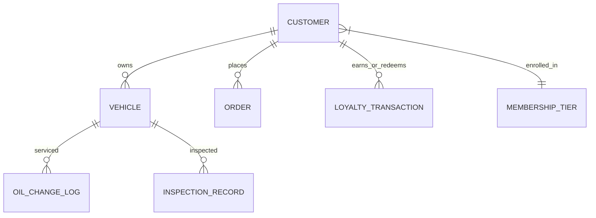
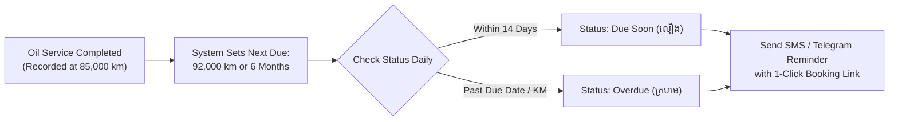

# 08. Customer Retention, Memberships, and Growth (ការរក្សាអតិថិជន និងភាពស្មោះត្រង់)

This chapter covers tools designed to increase repeat visits, customer lifetime value (LTV), and average ticket size: Customer Profiles, Loyalty Points, Membership Tiers, Automated Oil Reminders, and Upselling.

---

## 1. Customer & Vehicle Database (`views/owner/customers.php`)

Unlike simple POS registers that record anonymous sales, this system links every transaction to a **Customer Profile** and specific **Vehicle Records**.

* **Multiple Vehicles Per Customer**: A single customer (e.g. `Sophea Chan`) can have multiple vehicles registered (e.g. a family SUV `2A-1234` and a city commuter `2B-9876`).
* **Instant Apron Recognition**: When any linked plate is scanned or typed at the POS, the customer's full record, tier status, and service preferences are loaded automatically.
* **Vehicle History (`views/owner/vehicle_history.php`)**: Staff can inspect previous wash dates, technical inspections, oil brands used, and odometer readings to deliver personalized service.

---

## 2. Membership Tiers & Automatic Tier Progression

The system includes built-in membership tiering configured in `core/Loyalty.php` and `core/MembershipManager.php`:

| Tier Level | Qualification Threshold | Points Multiplier | Tier Perks & Benefits |
|---|---|---|---|
| **Standard (សំរិទ្ធ)** | Default for all new customers | **1.0x** (1 pt / $1 spent) | Standard queue priority (P3). |
| **Gold (មាស)** | 200+ Lifetime Points | **1.5x** (1.5 pts / $1 spent) | **10% Discount on Tire Wax & Detailing**, P1 Queue Priority. |
| **Platinum (ផ្លាកទីន)** | 500+ Lifetime Points | **2.0x** (2 pts / $1 spent) | **15% Discount on Detailing & Waxing**, VIP P0 Priority slot. |

* **Automatic Tier Elevation**: As customers visit and spend, their cumulative points automatically upgrade their tier status without manual staff intervention.
* **Monthly Subscription Memberships**:
  - For shops offering paid monthly wash packages (e.g. unlimited wash for $30/month), staff can assign a formal `membership_tier_id` with an explicit `expires_at` date in `views/owner/customers.php`.

---

## 3. Loyalty Points Earning & Redemption (`core/Loyalty.php`)

### Earning Points:
* **The Rule**: Customers earn points on all paid services and retail purchases.
* **Formula**:
  $$\text{Points Earned} = \text{Paid Total (USD)} \times \text{Tier Multiplier}$$
  *(e.g., A Gold member spending $20 earns $20 \times 1.5 = 30\text{ points})$.*
* Points are awarded automatically the moment the order status transitions to `paid`.

### Redeeming Points for Cash Credits:
* **Redemption Rate**: Every **10 points = $1.00 USD Credit**.
* **How to Redeem at POS**:
  1. Look up customer at POS.
  2. If customer has eligible points (e.g., `80 points = $8.00 credit`), the POS loyalty badge glows gold: `⭐ 80 pts available ($8.00 credit)`.
  3. Cashier asks customer: *"Would you like to redeem 50 points for a $5 discount today?"*
  4. Cashier enters points to redeem in the payment modal.
  5. The order total is discounted, and points are deducted from the customer's balance.

### Fraud Protection & Reversals:
* If an order is refunded or cancelled after completion, `Loyalty::reversePointsForOrder()` automatically reverses and claws back any awarded loyalty points to prevent point-farming fraud.

---

## 4. Smart Upsell Rules & Staff Commission Tracking

To boost average order value (AOV), the POS includes automated contextual upsell recommendations.

### Automated Contextual Prompts:
* When a **Basic Wash** is added to cart &rarr; System prompts: *"Add Premium Undercarriage Spray for +$2.00"*.
* When a **Standard Wash** is selected on a vehicle with dull paint &rarr; System prompts: *"Offer Ceramic Quick Spray Wax for +$3.00"*.
* When an **Engine Oil Change** is selected &rarr; System prompts: *"Recommend Engine Flush Solution for +$5.00"*.

### Logging Upsell Conversions:
* When staff successfully offer and add an upsell, the system records an entry in `upsell_logs`:
  `Shop: SHOP-PP-001 | Staff: Sokha | Item: Ceramic Wax | Price: $3.00 | Accepted: 1`.
* In **Back Office &rarr; Commissions** (`/commissions`), owners can view staff upsell conversion rates and pay performance bonuses.

---

## 5. Automated Oil Change Reminders (`views/owner/oil_care.php`)

Prevent customers from wandering to competitor workshops by tracking their service cycles automatically.

### The Dual-Trigger Rule:
An oil change reminder is triggered by **whichever threshold comes first**:
1. **Mileage Threshold**: $+7,000\text{ km}$ (for semi-synthetic) or $+10,000\text{ km}$ (for full synthetic) above the current odometer reading.
2. **Time Threshold**: Exactly **6 months** from the date of the last oil change.

### The Oil Care Dashboard (`views/owner/oil_care.php`):
* Filter tabs: **All Reminders**, **Due Soon (within 14 days)**, and **Overdue**.
* **Sending Reminders**:
  - Click **[Send Reminder via Telegram / SMS]** next to the customer.
  - The system sends a friendly branded message:
    *"Dear Sophea, your vehicle 2A-1234 is due for its scheduled oil service. Keep your engine running smoothly—tap here to book your slot at Car Wash & Care."*

---

## 6. At-Risk & Win-Back Customer Retention

A customer who used to visit every 2 weeks but hasn't appeared for 45 days is **At-Risk** of defecting to a competitor.

* **Identifying At-Risk Customers**:
  - In **Back Office &rarr; Customers &rarr; Retention Tab**, the system segments customers by visit recency:
    - **Active**: Last visit $\le 30$ days ago.
    - **Slipping**: Last visit $31 - 60$ days ago.
    - **At-Risk**: Last visit $61 - 90$ days ago.
    - **Lost**: No visit in $> 90$ days.
* **Win-Back Campaigns**:
  - Filter the list by "At-Risk" or "Lost".
  - Export customer phone numbers or trigger a bulk Telegram broadcast with a special incentive:
    *"We miss you! Visit us this week for an Express Wash and get a Free Tire Shine on us."*

---

## 7. Cloud Subscription Payment Recovery (Card Declines)

For chains operating automated recurring subscription memberships connected to the Cloud Sync Engine:

* **Cloud Processing**: The cloud repository automatically handles recurring bank card billing.
* **Card Decline Protocol**:
  1. If a customer's monthly payment card declines, the cloud marks the membership state as `payment_past_due` and syncs the flag to the shop server.
  2. The next time that vehicle pulls onto the apron and the cashier scans the plate, the POS screen displays an amber alert:
     `⚠️ Membership Renewal Past Due: Monthly renewal payment was declined.`
  3. Cashier politely notifies the customer: *"Dear customer, your monthly membership renewal was unable to process on your card. Would you like to settle the $30 renewal today via cash or ABA KHQR?"*
  4. Cashier takes payment at POS and the subscription status instantly reactivates across both the local server and the cloud network.
