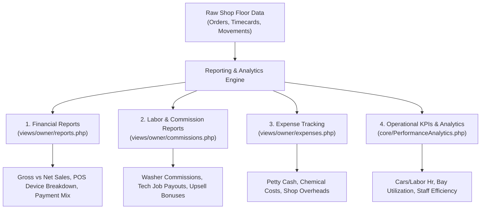

# 09. Operational Reports, Analytics, and KPIs (របាយការណ៍ និងសូចនាករប្រតិបត្តិការ)

A modern car wash cannot be run on intuition alone. This chapter explains the reports, analytical metrics, and managerial review cadences that turn shop data into profitability.

---

## 1. Executive Analytics & Reports Catalog

### A. Sales & Revenue Reports (`views/owner/reports.php`)
Accessible to: `owner`, `manager`, `system_admin`.
* **Date Range Filtering**: Today, Yesterday, This Week, This Month, Last Month, or Custom Date Picker.
* **Device Breakdown**: Filter sales by physical tablet, web register, or secondary device.
* **Key Metrics Displayed**:
  - **Gross Sales vs. Net Sales**: Subtotal before discounts vs. actual funds collected.
  - **Payment Method Distribution**: Exact percentage of revenue collected in Cash USD, Cash KHR, ABA Pay, and KHQR.
  - **Top Performing Services**: Ranking of wash packages by volume and gross dollar contribution.
  - **Top Retail & Lubricant Sales**: Fast-moving oils, wiper blades, and accessory sales.

### B. Expense Reports (`views/owner/expenses.php`)
* Tracks out-of-drawer petty cash (e.g., ice for staff, emergency hardware purchase) as well as recurring overheads (water utility, electricity, soap drum replenishment).
* Every expense specifies: Expense Date, Category, Amount in USD/KHR, and Staff Name.

### C. Staff Commissions & Payouts (`views/owner/commissions.php`)
* Eliminates end-of-month payroll disputes.
* **Washers**: Itemized list of vehicles washed and earned commission (e.g., $0.50 per wash).
* **Mechanics**: Flat rate or percentage earned per oil change / technical inspection completed.
* **Cashiers**: Bonus commissions earned on converted upsell items (e.g., $0.50 per ceramic wax upsell).

---

## 2. The 5 Core Operational KPIs (`core/PerformanceAnalytics.php`)

### KPI 1: Cars Per Labor Hour (ប្រសិទ្ធភាពការងារតាមម៉ោង)
* **What it measures**: Labor productivity across the entire wash apron.
* **The Formula**:
  $$\text{Cars Per Labor Hour} = \frac{\text{Total Completed Vehicles}}{\text{Total Clocked Staff Hours}}$$
* **Benchmark**:
  - **Target**: `2.0+ cars / hour` (configurable in Settings &rarr; `cars_per_labor_hour_target`).
  - **Below 1.5**: Overstaffed for the current customer volume, or severe delays in bay handovers.
  - **Above 3.0**: Exceptional speed, but inspect quality to ensure staff aren't rushing drying stages.

---

### KPI 2: Bay Utilization Percentage (អត្រាប្រើប្រាស់កន្លែងលាង)
* **What it measures**: What percentage of open business hours a bay actually spent washing cars vs. sitting idle.
* **The Formula**:
  $$\text{Bay Utilization} = \frac{\text{Total Active Washing Minutes}}{\text{Total Operating Hours} \times 60 \times \text{Total Bays}} \times 100\%$$
* **Benchmark**:
  - **Optimal Range**: `65% – 80%`.
  - **Above 85%**: The shop is at capacity. Customer waiting lines exceed 45 minutes; consider adding an express lane or expanding bays.
  - **Below 40%**: Underutilized capital. Run promotional discount campaigns during slow mid-week mornings (Tuesday/Wednesday).

---

### KPI 3: Technician & Washer Efficiency Factor (មេគុណប្រសិទ្ធភាពជាង)
* **What it measures**: How fast an individual staff member works compared to system standard estimates.
* **The Formula**:
  $$\text{Efficiency \%} = \frac{\text{Catalog Estimated Minutes}}{\text{Actual Recorded Minutes}} \times 100\%$$
* **Interpretation**:
  - **100%**: Staff works exactly at standard speed.
  - **115%**: Fast, skilled operator finishing tasks 15% faster than expected.
  - **Below 80%**: Consistently slow operator. SmartQueueEngine adjusts their multiplier so customer wait time estimates remain realistic.

---

### KPI 4: Average Revenue Per Car / Ticket Size (ចំណូលមធ្យមក្នុងមួយរថយន្ត)
* **What it measures**: How effectively the shop cross-sells detailing, lubricants, and refreshments.
* **The Formula**:
  $$\text{Average Ticket} = \frac{\text{Total Net Sales (USD)}}{\text{Total Invoiced Vehicles}}$$
* **Growth Goal**: Moving a shop from $5.00 average ticket (wash only) to $12.50 average ticket (wash + tire shine + air freshener + oil change).

---

### KPI 5: Average Customer Wait Time (រយៈពេលរង់ចាំមធ្យម)
* Tracked from the minute a ticket is created at POS until the vehicle is marked "Finished" on the TV board.
* Reports show wait times broken down by service category (e.g. Basic Wash: 18 mins; Full Polish & Detailing: 95 mins).

---

## 3. Staff Performance Leaderboard (`views/owner/reports.php`)

To build healthy competition among bay teams, the system features a live **Staff Leaderboard**:
* Ranks washers and mechanics by:
  1. Total cars completed this week / month.
  2. Efficiency score percentage.
  3. Customer satisfaction / zero-damage record.
  4. Total commission earned.
* Owners can display the leaderboard in the staff breakroom or award monthly "Employee of the Month" bonuses.

---

## 4. Business Owner Review Cadences

Successful shop owners follow a disciplined 3-tier review schedule:

### A. The Daily Close Cadence (5 Minutes at 6:30 PM)
1. **Verify Day Close Z-Report**:
   - Compare physical cash counted against the Z-report expected cash.
   - Note any shortage owed by outgoing cashiers.
2. **Reconcile Bank Transfers**:
   - Open mobile banking app (ABA / Bakong) and confirm that today's digital deposits match POS ABA and KHQR totals.
3. **Scan Audit Logs (`/owner/audit_logs`)**:
   - Check if any refunds (`MANAGER_REFUND`) or drawer pops (`DRAWER_OPEN_NO_SALE`) occurred. Verify manager justifications.

### B. The Weekly Operational Cadence (20 Minutes every Monday Morning)
1. **Bay Utilization Check**:
   - Review which hours had low utilization. Schedule equipment maintenance or chemical inventory replenishment during those slow windows.
2. **Review Duration Overruns (`service_duration_reviews`)**:
   - Review services that took >20% longer than expected. Accept catalog duration adjustments if vehicles consistently take longer.
3. **Approve Staff Commissions**:
   - Review and sign off on weekly commission balances before payroll disbursement.
4. **Inspect Reorder Alerts**:
   - Check warehouse stock ledger for items below minimum threshold; place supplier orders.

### C. The Monthly Financial Cadence (45 Minutes on the 1st of the Month)
1. **Net Profit Calculation**:
   $$\text{Net Profit} = \text{Gross Inflows} - (\text{Petty Cash Expenses} + \text{Chemical Inventory Cost} + \text{Staff Payroll \& Commissions} + \text{Rent \& Utilities})$$
2. **Customer Retention Review**:
   - Check the **At-Risk Customers** list. Launch targeted SMS/Telegram win-back promotions.
3. **Catalog Price Review**:
   - Review labor costs vs. service prices. Adjust vehicle size multipliers if larger SUVs are absorbing disproportionate washing shampoo and labor.
