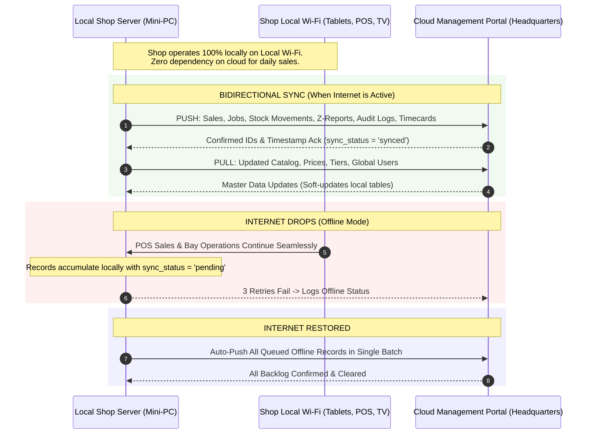

# 10. Cloud Synchronization, Offline Mode, and Disaster Recovery (ការធ្វើសមកាលកម្មក្លោដ និងការសង្គ្រោះទិន្នន័យ)

The Car Wash & Detailing Management System uses an **Autonomous Local-First Architecture**. Your physical shop is powered by an independent mini-PC that continues working even during internet blackouts, while synchronizing with the central headquarters cloud whenever online.

---

## 1. System Sync Architecture

---

## 2. Bidirectional Sync Specifications (`core/CloudSyncManager.php`)

### A. The PUSH Contract (Shop &rarr; Cloud)
Every 5 minutes (or via manual trigger), the local client inspects all unsynced local rows and packages them into a signed push payload:

| Data Category | Contract Payload Key | Local Tables Synchronized |
|---|---|---|
| **Completed Sales** | `sales` | `orders` where `status = 'paid'` |
| **Bay Job Orders** | `job_orders` | `orders`, `order_tasks`, `order_washers` |
| **Warehouse Movements** | `stock_movements` | `stock_movements` (Immutable append-only ledger) |
| **Shifts & Day Closes** | `shifts_and_zreports`| `cashier_shifts`, `daily_zreports` |
| **Security Audit Logs** | `audit_logs` | `audit_logs` |
| **Customer Events** | `crm_events` | `customer_interactions`, `feedback` |
| **Staff Upsells** | `upsell_logs` | `upsell_logs` |
| **Labor Attendance** | `timecards` | `timecards` (Clock-in, clock-out, total hours) |
| **Analytics Metrics** | `performance_metrics`| Daily bay utilization, cars per labor hour, wait times |

When the cloud confirms receipt, the local server flags those records with `sync_status = 'synced'`, ensuring no record is pushed twice.

### B. The PULL Contract (Cloud &rarr; Shop)
Headquarters pushes master catalog updates down to the shop:
* **Catalog Items**: Service packages, retail products, category hierarchies.
* **Pricing Matrices**: Vehicle-type prices in `service_prices`.
* **Membership Tiers**: Points multipliers, wax discounts, subscription plans.
* **Vehicle Specs**: Lubricant recommendations, oil capacities, filter part numbers.
* **Cloud-Managed Users**: Global administrators, owners, managers, and CRM staff.

### Safety Guards in CloudSyncManager:
1. **Soft Deactivation Only**: If a cloud user or product arrives with `is_active = 0`, the local record is marked `inactive`. It is **never deleted**.
2. **Session Termination**: If a cloud user is deactivated, the system immediately closes their active POS sessions in `pos_sessions` to log them out instantly.
3. **Last-Owner Guard**: The system **strictly refuses** to deactivate the last active owner account on the local server, preventing accidental lockout.
4. **Local Vehicle Prices Preserved**: If local pricing matrices have customized per-vehicle rates, the system prevents a generic flat price from overwriting vehicle-specific pricing.

---

## 3. Cryptographic Signing & Security

All communication with the cloud is hardened against interception, spoofing, and tampering:
* **Gzip Compression**: Payloads are compressed with `gzencode()` to reduce mobile data usage on 4G backup modems.
* **HMAC-SHA256 Signing**:
  $$\text{Signature} = \text{hash\_hmac}('sha256', \text{timestamp} + '.' + \text{nonce} + '.' + \text{compressed\_bytes}, \text{cloud\_secret})$$
* **Security Headers**:
  - `X-Shop-Token`: Unique shop authentication token.
  - `X-Shop-Timestamp`: Unix epoch timestamp (stale requests > 5 minutes are rejected).
  - `X-Shop-Nonce`: Cryptographic random string preventing replay attacks.
  - `X-Shop-Signature`: Computed HMAC signature.
* **Timeout & Retry Policy**: 15-second timeout, 3 attempts spaced 10 seconds apart.
* **Strict Production TLS**: SSL verification is enforced. Insecure certificates are rejected unless explicitly running in local development mode.

---

## 4. Operating in Local Offline Mode

When your shop's fiber optic internet or 4G router goes down:

### What Continues Working Normally:
- ✅ **Cashier POS**: Registers process sales, calculate change, apply member discounts, and open cash drawers.
- ✅ **Receipt Printing**: Thermal printers connected via USB or local LAN print receipts immediately.
- ✅ **Wash & Tech Bays**: Tablets at Bay 1, 2, 3, and 4 continue displaying job cards, countdown timers, checklists, and parts requests.
- ✅ **Waiting Lounge TV**: The public TV display (`tv.php`) continues updating vehicle statuses via local LAN Server-Sent Events.
- ✅ **Shift Handover & Spot Audits**: Cash counts and variance math operate uninterrupted.

### What is Paused / Blocked During Offline Mode:
- ❌ **Cloud Sync**: Queued locally; no data loss occurs.
- ❌ **Refund Processing**: As a fraud prevention rule (`core/CashierControl.php`), digital refunds are **strictly blocked while offline** (`is_offline = true`). Use the manager paper refund voucher until internet resumes.
- ❌ **Dynamic Cloud Lookups**: New membership subscriptions registered on other branch shops will sync upon reconnection.

---

## 5. Total Power Failure: Disaster Mode Paper Forms (`views/recovery/paper_forms.php`)

If a catastrophic municipal blackout cuts electrical power and the UPS battery backup exhausts:

### Step 1: Distribute Pre-Printed Disaster Forms
Keep a folder of pre-printed forms in the cashier desk:
* **Printable Paper Job Cards** (`views/recovery/paper_forms.php?form=job_card`):
  - Pre-numbered slip boxes: Paper Slip #, Customer Plate, Vehicle Type, Selected Services, Cash Received, Assigned Washer.
  - Tear-off bottom receipt stub given to customer ("No Receipt, No Wash").
* **Disaster Logbook Sheet** (`views/recovery/paper_forms.php?form=logbook`):
  - Sequential paper logbook tracking cars, entrance time, exit time, and cash collected.

---

## 6. Post-Disaster Digitization: Bulk Entry (`views/recovery/bulk_entry.php`)

Once electricity is restored, staff must record all handwritten paper tickets into the computer to reconcile money and stock.

* **Who does it**: Cashier or Shift Manager (Requires `recovery.create`).
* **Where**: Recovery Menu &rarr; **Disaster Recovery: Bulk Paper Entry**.
* **Step-by-Step Procedure**:
  1. Open `views/recovery/bulk_entry.php`.
  2. You will see an ultra-fast data entry grid designed for 10-key keyboard entry.
  3. For each paper job card:
     - Type **Paper Slip #** (e.g. `P-041`).
     - Type **Plate Number** (e.g. `2A-1234`).
     - Select **Vehicle Type** (e.g. `SUV`).
     - Select **Service / Product** (e.g. `Premium Wash`).
     - Type **Total Amount Paid** (USD / KHR).
     - Select **Payment Method** (`Cash` or `Bank Transfer`).
     - Select **Assigned Washer / Mechanic**.
     - Type approximate arrival timestamp.
  4. Click **[+ Add Row]** to add as many paper slips as necessary.
  5. Click **[Save All Recovery Orders]**.
  6. The system:
     - Creates official paid order records linked to the paper slip reference.
     - Commits any product stock used from the warehouse ledger.
     - Credits washer commissions to the designated staff.
     - Adds cash inflows into today's register drawer balance.
     - Writes a single `BULK_RECOVERY_IMPORT` audit log entry.

---

## 7. Cloud Sync Monitor (`views/owner/sync_monitor.php`)

Shop owners and managers can verify cloud connectivity at any time:

* **Where**: Back Office Menu &rarr; **Cloud Sync &rarr; Sync Monitor**.
* **Health Indicators**:
  - **Online Status**: Green `ONLINE` or Orange `OFFLINE MODE`.
  - **Unsynced Backlog Counter**: Displays exact pending records:
    `Pending Push: 14 Orders, 2 Shifts, 8 Stock Movements`.
  - **Last Successful Upload**: Date and time of the last confirmed cloud push.
  - **Last Successful Download**: Date and time of the last catalog pull.
* **Action Buttons**:
  - **[Force Push to Cloud Now]**: Immediately dispatches all pending local records.
  - **[Pull Master Catalog Now]**: Pulls latest price adjustments and global user accounts.
* **Sync Logs Table**:
  - Complete history of the last 25 push/pull attempts, including duration in milliseconds (`duration_ms`), records transferred, and full error messages if a connection dropped.
