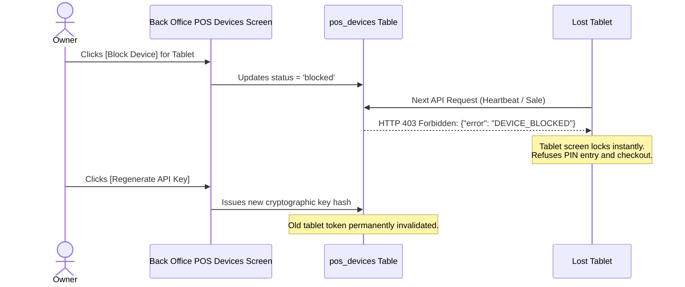

# 11. Month-End Procedures, Staff Lifecycle, and System Maintenance (ការគ្រប់គ្រងចុងខែ និងការថែទាំប្រព័ន្ធ)

This chapter guides the shop owner and general manager through long-term maintenance routines: automated backups, staff onboarding and departures, securing lost tablets, catalog pricing reviews, and month-end financial balancing.

---

## 1. Automated Backups & Disaster Restoration (`core/Backup.php`)

Your business database contains every historical sale, vehicle record, and financial transaction. Protecting it is non-negotiable.

### A. The 14-Day Rolling Backup System:
* **Automated Schedule**: Every night at 2:00 AM, `Backup::runDailyBackup()` runs an automated database dump.
* **Storage Location**: `storage/backups/CarWash_AutoBackup_YYYY-MM-DD.sql`.
* **Pruning / Retention**: Backups older than **14 days** are rotated and pruned automatically to prevent filling up the mini-PC storage.
* **Audit Logging**: Every backup completion is recorded in `storage/logs/backup.log` and logged in `audit_logs` under `BACKUP_AUTOMATIC`.

### B. Offsite Backup Best Practice (Crucial for Shop Owners):
> [!TIP]
> **THE 3-2-1 BACKUP RULE**:
> Never leave backups exclusively on the mini-PC hard drive. If the shop suffers a flood, lightning strike, or hardware failure, the mini-PC drive may be lost.
> **Every Saturday**, insert a small USB flash drive into the mini-PC, copy the latest `.sql` file from `storage/backups/`, and take it home.

### C. Emergency Restoration Procedure:
If a hard drive fails and you replace the mini-PC:
1. Reinstall XAMPP and configure MySQL database `car_wash`.
2. Open PowerShell in the project directory:
   ```powershell
   mysql -u root -p car_wash < storage/backups/CarWash_AutoBackup_2026-11-01.sql
   ```
3. Run the go-live sanity check script:
   ```powershell
   php scripts/go_live_check.php
   ```
4. Verify all green checks; the shop is restored with full historical continuity.

---

## 2. Staff Lifecycle: Onboarding & Departures (`views/owner/staff.php`)

### A. Onboarding New Staff:
1. Navigate to **Staff & Permissions &rarr; Staff Management** (`/owner/staff`).
2. Click **[+ Add New Staff]** (បន្ថែមបុគ្គលិកថ្មី).
3. Fill out:
   - Full Name (e.g. `Vireak Roth`)
   - Phone Number (e.g. `098 765 432`)
   - Unique Username (e.g. `vireak_w`)
   - Role: Select exact role (`washer`, `mechanic`, `cashier`, `stock_control`, `manager`).
   - Initial 6-digit PIN.
   - Commission Type (Flat rate per vehicle or percentage) and Commission Rate.
4. Instruct new staff to log in and immediately change their temporary PIN to a private one via **Change PIN** (`views/auth/change_pin.php`).

### B. Staff Departure: Soft Deactivation (Never Delete!)
> [!CAUTION]
> **NEVER DELETE A FORMER EMPLOYEE RECORD**:
> Staff records must **NEVER be deleted** from the database (`DELETE FROM users`). Deleting a user destroys historical foreign keys: who washed car #1024, who authorized refund #44, and whose drawer was short on May 12th.

### The Correct Offboarding Steps:
1. Open **Staff Management** (`/owner/staff`).
2. Locate the departing staff member and click **[Edit]** or tap the status toggle button.
3. Change **Status** from `active` to **`inactive`** (អសកម្ម).
4. Tap **[Save Staff]**.
5. The system immediately:
   - Blocks the account from logging into POS or Back Office.
   - Terminates any active POS sessions in `pos_sessions`.
   - Removes the staff member from active bay assignment dropdowns.
   - Retains 100% of their historical commission records, past orders, and audit log entries intact.

### The Last-Owner Safety Guard:
The system contains an automated security check:
`Action blocked: You cannot deactivate or demote the last active Owner account.`
This prevents an owner from accidentally locking themselves out of their own system.

---

## 3. Securing Lost or Stolen POS Tablets (`views/owner/pos_devices.php`)

If a wash bay tablet or cashier tablet is misplaced or stolen from the shop:



### Step-by-Step Device Lockdown:
1. Open **Settings &rarr; POS Devices** (`views/owner/pos_devices.php`).
2. Locate the compromised tablet (e.g. `Bay 2 Samsung Tablet - UID: POS-BAY2`).
3. Click the red button **[Block Device]**.
4. Status changes to **BLOCKED**.
5. The moment anyone taps the lost tablet, the app immediately rejects all commands with error code `DEVICE_BLOCKED`.
6. Click **[Regenerate API Key]** to permanently invalidate the stored cryptographic pairing token.
7. Pair a replacement tablet using the new pairing code.

---

## 4. Periodic Catalog & Price Maintenance

Every quarter or before high-demand holiday seasons (e.g. Khmer New Year, Pchum Ben):

1. **Review Vehicle Size Pricing Matrix (`views/owner/services.php`)**:
   - Inspect labor time and shampoo consumption. If large pickups and heavy 4x4s take 35% more labor, ensure their prices reflect this difference (e.g., Small Car: $4.00, SUV: $7.00, Large Pickup: $8.50).
2. **Review Lubricant Costs (`views/owner/categories.php`)**:
   - If suppliers raise bulk oil prices by $0.50/L, update product retail prices in the catalog so workshop profit margins are preserved.
3. **Calibrate Base Durations (`service_duration_reviews`)**:
   - Review services that frequently trigger duration warnings in SmartQueueEngine and adjust base minutes to keep customer wait time expectations realistic.

---

## 5. Month-End Financial Reconciliation Checklist

On the final day of each calendar month, perform this 5-step closing routine:

- [ ] **Step 1: Daily Z-Reports vs. Bank Statements Reconciliation**
  - Verify that the sum of all monthly Z-Reports matches the cash deposited into your physical bank account plus digital ABA/KHQR inflows.
- [ ] **Step 2: Staff Commission Payouts (`views/owner/commissions.php`)**
  - Review commission totals for all active washers, mechanics, and cashiers.
  - Print the monthly commission summary for staff signature sign-off and disburse payroll.
- [ ] **Step 3: Petty Cash & Expense Clearance (`views/owner/expenses.php`)**
  - Verify all receipts for out-of-drawer petty cash purchases (ice, brooms, emergency hardware).
  - Ensure total recorded expenses match the cash deducted from shift drawers.
- [ ] **Step 4: Physical Stocktake & Write-Off Review (`views/owner/stock_ledger.php`)**
  - Perform a complete count of all engine oils, filters, and retail merchandise.
  - Log any discrepancies using **Add Correction Line** with Manager PIN and reason note.
- [ ] **Step 5: Month-End Database Archive**
  - Trigger a manual database backup via `Backup::generateSql()` and store a copy in the permanent monthly archive folder.
